<p align="center">
  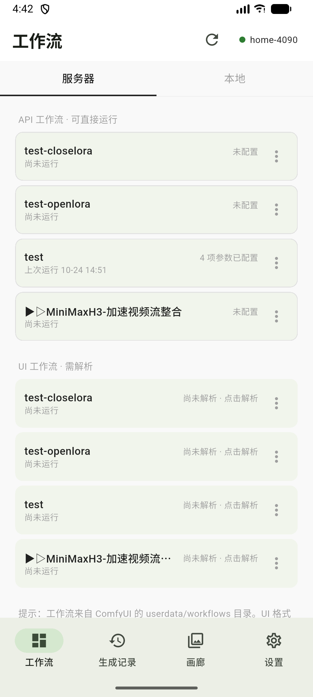
  &nbsp;
  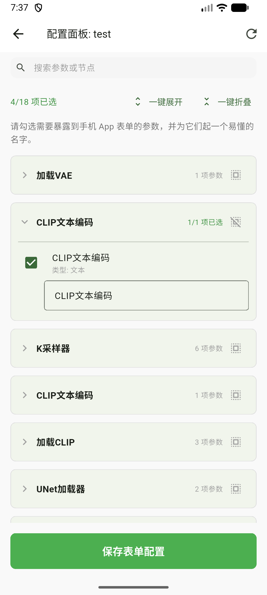
  &nbsp;
  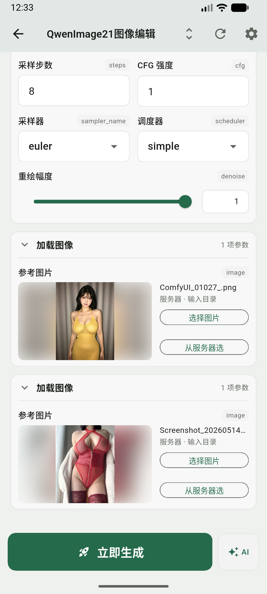
  &nbsp;
  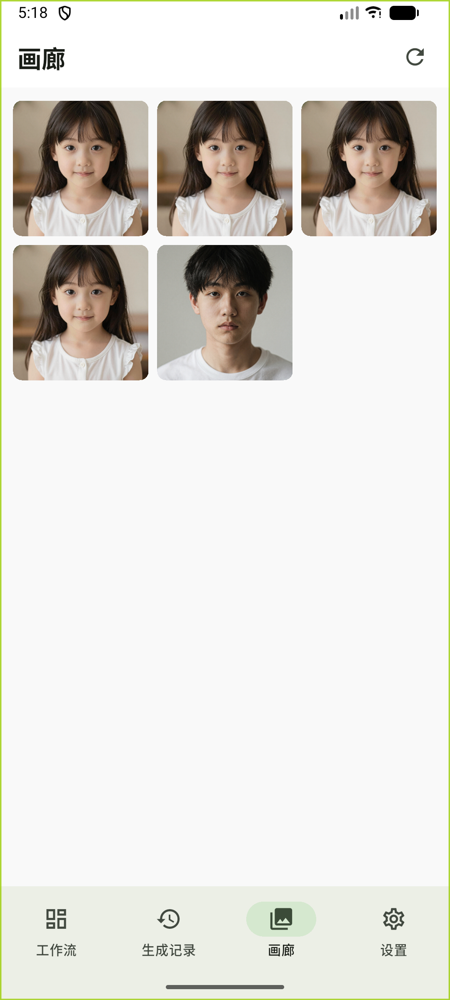
</p>

<div align="center">

<h1>ComfyUI Pocket</h1>

<p><strong>你的 ComfyUI 已经在跑了 —— 这个 App 让你在手机上挑参数、下任务、收结果。</strong></p>

<p>连上服务器就能浏览工作流、把常用参数变成一张表单、一键下发生图任务、实时看进度，出图自动回到手机相册。</p>

<p><sub>本应用为第三方工具，与 ComfyUI 官方无隶属关系。</sub></p>

<p>
  <a href="https://github.com/Volitasa/ComfyUI-MobilePocket/releases/latest"><b>⬇️ 下载 APK</b></a>
  ·
  <a href="#三步上手"><b>🚀 三步上手</b></a>
  ·
  <a href="#七常见问题与排查"><b>❓ 常见问题</b></a>
  ·
  <a href="#十一未来计划"><b>🗺️ 未来计划</b></a>
</p>

<p><b>简体中文</b> ｜ <a href="README_EN.md">English</a></p>

<p>
  
  
  
  
</p>

</div>

<p align="center"><i>Android 模拟器实拍：工作流列表 → 参数配置 → 任务进度 → 本地画廊</i></p>

> 本文所有截图都取自 Android 模拟器上的真实运行界面：`docs/screenshots/zh` 为中文界面，`docs/screenshots/en` 为英文界面。

**唯一前提**：手机能访问到那台跑着 ComfyUI 的机器（同一局域网 Wi-Fi，或已做内网穿透 / 公网映射）。服务器开着就行。

## 连上就能用：它替你省掉了什么

| 常见的麻烦 | 这个 App 怎么做 |
| --- | --- |
| 想把界面保存的工作流拿到手机上跑，得先手动转成 API 格式 JSON | **不用转。** 服务器上的工作流——包括 ComfyUI 界面保存的 UI 格式——App 自己解析成可执行结构，点一下「解析」就能跑 |
| 要把 JSON 文件导进手机 | **不用导。** 刷新即得服务器 `userdata/workflows/` 里的全部工作流 |
| 装插件、开 SSH、记节点 ID | **都不用。** 只要你在电脑上正常保存过工作流，手机上就能看到它。装 [ComfyUI-AutoSaveAPI](https://github.com/Volitasa/ComfyUI-AutoSaveAPI) 只是额外导出一份"可直接运行"的档，省掉那一下"解析"，**不是必需** |

## 核心能力

1. **连上就能跑** —— 填上服务器地址，工作流列表立刻出来；UI 格式在 App 内解析成可运行结构；本地 JSON 也能导入。
2. **参数变表单** —— 自动识别节点参数，勾选要调的项、起个好记的别名，运行页按类型生成控件（文本 / 种子 / 整数 / 小数 / 滑块 / 开关 / 下拉 / 图片，空画布节点的宽高还是一张尺寸卡）。**下拉里的选项是服务器上真实存在的**，可以直接换模型、不用回电脑改工作流。配置页只摆你已经放进表单的参数，全量参数收进「添加参数」页按用途分段，节点再多也不会淹没你。
3. **出图回到手机** —— WebSocket 实时进度 + 五态任务管理；出图自动下载进本地画廊（保留 PNG 元数据，可拖回 ComfyUI 复现），可存进手机相册；每条记录都能「再次运行」还原当时的参数。
4. **提示词可以让 AI 搭把手（可选）** —— 接你自己的 AI 服务（内置 DeepSeek 预设，也能填任意 OpenAI 兼容接口），帮你改写提示词、看图写词；只改文本、只动你指定的那一个参数，写入前有四条校验，写完可撤销。不配也能正常用，功能不强制。

**正在做的一件事**：接入 RunningHub 云端工作流 —— 详见 [未来计划](#十一未来计划)。

## 三步上手

1. **装好 APK** → 打开后进入 **设置 → 服务器连接 → 新增**，填上地址（如 `http://192.168.1.100:8188`）保存。第一个连接自动启用，顶部徽标变绿即已连上。
2. **工作流 Tab** 里点你的工作流 → 配置页**已经替你挑好了一批常用参数**，缺的进「添加参数」补上、起个好记的名字 → 保存。UI 格式的先点一下「解析」（首次要加载一次服务器前端，几秒到十几秒）。
3. **点「立即生成」** → 自动跳到生成记录，看着它从"排队中"跑到"已完成" → 点缩略图看大图、保存进相册。

想再出一版？回生成记录点这张卡片的**再次运行**，表单结构和参数全部就位。

想让 AI 帮改提示词？运行页「立即生成」右边有个 **AI** 按钮（首次用要先在 **设置 → 连接 → AI 服务** 配一次，见 [5.11](#511-提示词-ai-助手)）。

---

## 目录

- [一、完整能力清单](#一完整能力清单)
- [二、开始之前：你需要准备什么](#二开始之前你需要准备什么)
- [三、安装与首次连接](#三安装与首次连接)
- [四、界面导览](#四界面导览)
- [五、功能详解](#五功能详解)
  - [5.1 连接管理](#51-连接管理)
  - [5.2 工作流的三条来源](#52-工作流的三条来源)
  - [5.3 参数配置面板](#53-参数配置面板)
  - [5.4 运行页](#54-运行页)
  - [5.5 任务跟踪](#55-任务跟踪)
  - [5.6 生成记录与再次运行](#56-生成记录与再次运行)
  - [5.7 工作流快照](#57-工作流快照)
  - [5.8 画廊与保存到相册](#58-画廊与保存到相册)
  - [5.9 设置中心](#59-设置中心)
  - [5.10 应用内更新](#510-应用内更新)
  - [5.11 提示词 AI 助手](#511-提示词-ai-助手)
- [六、功能之间的关联逻辑](#六功能之间的关联逻辑)
- [七、常见问题与排查](#七常见问题与排查)
- [八、已知限制](#八已知限制)
- [九、技术栈与项目结构](#九技术栈与项目结构)
- [十、开发、测试与发布](#十开发测试与发布)
- [十一、未来计划](#十一未来计划)

---

## 一、完整能力清单

开头已列出四条主线，这里是全部能力，后面 [五、功能详解](#五功能详解) 逐项展开。

| 能力 | 说明 |
| --- | --- |
| 多服务器连接 | 保存多套服务器（家里内网 / 公司外网），每条可设**主地址 + 备用地址**，主的不通自动回退 |
| 三种工作流来源 | 服务器 `_api.json` 直接跑；服务器 UI 格式 JSON **在 App 内解析成 API 结构**再跑；本地 JSON 文件导入 |
| 参数变成表单 | 按**数据化规则表**识别节点参数，勾选要暴露的项、起别名，运行页按类型生成控件（文本/种子/整数/小数/开关/下拉/图片）；配置页主视图只放已选参数，全量收进「添加参数」页按用途分段，支持搜索、批量展开折叠、节点内全选 |
| 模型下拉取真选项 | 打开运行页时向服务器问一次，模型（Checkpoint / UNET / CLIP / VAE / LoRA / ControlNet）与采样器、调度器的下拉里就是**服务器上真实存在的清单**；右上角可手动刷新。工作流里的模型若服务器上没有，会标注出来并在提交前拦下 |
| 实时进度 | WebSocket 回推，显示当前正在执行的节点与百分比；断线自动重连并主动向服务器对账，**回到前台也会自动补齐进度** |
| 五态任务管理 | 排队中 / 生成中 / 已完成 / 已失败 / 已中断，失败时展示服务器返回的具体错误原因 |
| 再次运行 | 每次运行自动固化快照，任何一条历史记录都能凭快照还原当时的表单与参数，一键重跑 |
| 记录搜索与筛选 | 生成记录可按工作流名 / 提示词 / 参数别名搜索，按 5 种状态筛选，并显示"为什么匹配"的命中摘要 |
| 参数拖动排序 | 配置页主视图按节点分段，**长按任意一段**即可整段拖动排序；顺序会落盘，运行页的卡片顺序跟着变 |
| 从服务器目录选图 | 图片参数除了从手机相册选，还能**直接选服务器上的图**（输出目录 / 输入目录两个 Tab）；选中值带目录注解原样提交，不用先上传 |
| 看图对比 | 生成记录与画廊的看图页底部有**参考图缩略条**：点一下切换、按住临时对比，松手回到出图；图片支持双击放大，三处查看器共用一套手势 |
| 外观与深色 | 设置 → 通用 → 外观：跟随系统 / 浅色 / 深色。深色是整套语义色，不是简单反色；冷启动底色也跟着明暗走，不会先闪一下白 |
| 震动反馈 | 可选，6 类操作分别开关（切换标签页 / 勾选参数 / 拖动排序 / 折叠卡片 / 提交成功 / 长按看图） |
| 提示词 AI 助手 | 可选，接你自己填的 OpenAI 兼容服务：改写提示词、看图写词；写入前四条校验，写完可撤销 |
| 本地画廊 | 出图自动下载到 App 沙盒，**保留原始 PNG 元数据**（可拖回 ComfyUI 复现），支持网格浏览与大图查看；视频在生成记录的查看器里播放 |
| 保存到相册 | 可选"带工作流原图"或"剔除元数据的普通图片" |
| 中英双语界面 | 界面语言可跟随系统或手动指定中文 / 英文；持久化数据不存展示文案，切语言不影响历史记录 |
| 应用内更新 | 手动检查 GitHub Releases，下载 APK 并唤起系统安装（私有 / 公开仓库都支持） |

---

## 二、开始之前：你需要准备什么

**只有一条**：一台正在运行、且手机能访问到的 ComfyUI。App 通过 HTTP 与 WebSocket 和它通信，启动时用 `GET /system_stats` 探测连通性（所以服务器要先开着）。

插件是**可选**的：[ComfyUI-AutoSaveAPI](https://github.com/Volitasa/ComfyUI-AutoSaveAPI) 会在你**保存工作流时**额外导出一份 `_api.json`（即可直接运行的那档），能省掉 App 内解析这一步。**没装也完全能用** —— 电脑上正常保存的工作流本来就在服务器的 `userdata/workflows/` 里，App 刷新就能看到并解析。

两种 JSON 格式的区别了解即可，App 会自动判断该走哪条路：

| 格式 | 长什么样 | App 怎么用 |
| --- | --- | --- |
| **API 格式**（文件名以 `_api.json` 结尾） | 以**节点 ID 为键**，每项含 `class_type` 与 `inputs` | **直接运行**（不用解析） |
| **UI 格式**（普通 `*.json`） | 顶层是 `nodes` / `links` 数组，是 ComfyUI 界面保存的原始结构 | **点一下「解析」**就能运行（详见 [5.2](#52-工作流的三条来源)） |

---

## 三、安装与首次连接

1. 下载最新版本的 APK 并安装（Android 需要允许"安装未知来源应用"）。
2. 打开 App，进入 **设置 → 服务器连接 → 新增连接**。
3. 填写：
   - **名称**：给自己看的，例如"家里 4090"
   - **主地址**：例如 `http://192.168.1.100:8188`（局域网地址）
   - **备用地址**（可选）：例如外网穿透地址。主地址不通时自动尝试
4. 点**测试连接**验证，然后**保存**。第一个连接会自动启用。
5. 回到**工作流** Tab，顶部状态徽标变绿即表示已连上（徽标同时要求 HTTP 探测成功 **且** WebSocket 已建立）。

> 提示：App 每次启动会先尝试上次成功过的地址（快速路径），失败才走完整的主备探测，所以日常打开几乎无感。

---

## 四、界面导览

底部四个 Tab：

| Tab | 作用 |
| --- | --- |
| **工作流** | 挑工作流、配参数、进运行页。顶部有「服务器 / 本地」两段切换 |
| **生成记录** | 所有下发过的任务，看状态、看结果、搜索筛选、再次运行、删除 |
| **画廊** | 所有已下载到本机的生成结果，网格浏览 |
| **设置** | 分三段：连接（服务器连接、AI 服务）/ 数据（工作流存储、工作流快照）/ 通用（界面语言、外观、震动反馈、GitHub 令牌、关于） |

**工作流**页与**生成记录**页顶部有 **连接状态徽标**（服务器名 + 状态圆点），点它直达服务器配置页。画廊页与设置页没有这个徽标。

<p align="center">
  
  &nbsp;
  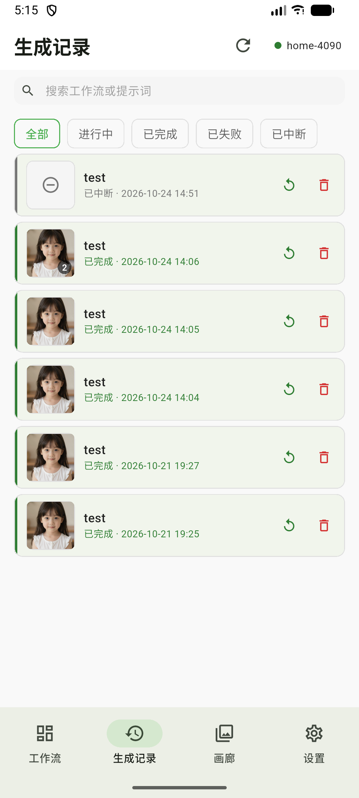
  &nbsp;
  
  &nbsp;
  
</p>

<p align="center"><i>四个 Tab 依次为：工作流 / 生成记录 / 画廊 / 设置</i></p>

---

## 五、功能详解

### 5.1 连接管理

多套服务器配置，每套可设主地址与备用地址，主的不通自动回退。

**能做什么**

- 保存任意多套服务器配置，同一时刻只启用一套。
- 每条配置可设主地址与备用地址，连接时依次探测，用第一个连通的。
- 新增/编辑时可单独"测试连接"，不改变当前启用状态。
- 点卡片即可切换启用；切换后重新探测并刷新工作流列表。

**关键行为**

| 操作 | 会发生什么 |
| --- | --- |
| 切换服务器 | 清空工作流列表与当前工作流缓存；**不影响**本地生成记录、画廊、本地工作流 |
| 删除服务器 | 断开连接，并**连带清理该服务器名下的解析缓存**（那些缓存再也无从校验） |
| 断线 | WebSocket 按 3s → 6s → 12s 递增间隔**最多重试 3 次**，试满即停（服务器关着时无限重试是白耗电），切换服务器、重新测试连接或回到前台会重新给机会 |
| 连接（重新）建立成功 | 自动拉取工作流列表，并对账**当前服务器名下**未终结的任务。仅 WebSocket 单独重连不触发这一组动作 |
| 编辑并保存 | 改的是**当前启用中**的连接时，会立刻重新探测主备地址（生效地址可能从主切到备） |

<p align="center">
  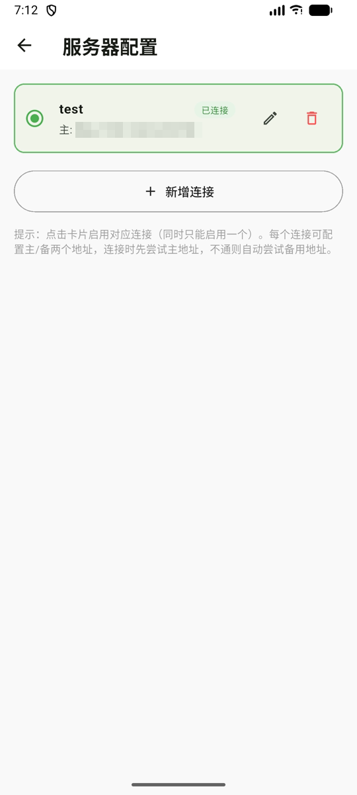
</p>

<p align="center"><i>服务器配置：点卡片启用，铅笔编辑，垃圾桶删除</i></p>

### 5.2 工作流的三条来源

这是理解整个 App 的**第一块基石**。工作流有三个来源，它们的"身世"不同，因此能做的操作也不同：

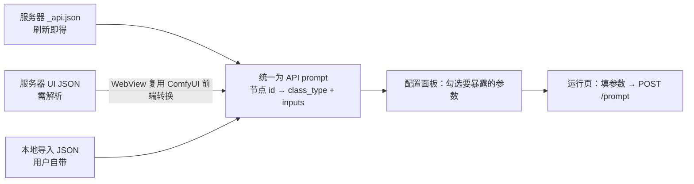

| 来源 | 存在哪 | 能否"再生" | 提供的操作 |
| --- | --- | --- | --- |
| 服务器 `_api.json` | 只存在服务器，App 不落盘（只存参数配置与内容哈希） | 能（刷新即得） | 刷新内容（只重查这一条） / 重新配置节点 / **存入本地库** |
| 服务器 UI JSON 解析 | 解析结果缓存在本机（键：服务器 + 文件名） | 能（再解析一次） | 解析 / 重新解析 / **清除解析缓存**（不叫删除） |
| 本地导入 | 完整保存在本机 | **不能**（删了就没了） | 重命名 / 重新配置节点 / **删除** |

> 设计原则：**能否删除 = 能否从源头重新获得。** 能从源头再拿一次的，就不给你"删除"，只给"重新同步"；删了就没的，才给完整的增删改。

#### 服务器段：按格式分组

- **API 工作流 · 可直接运行**：点进去就能配参数或进运行页。
- **UI 工作流 · 需解析**：首次需手动点解析。解析后的条目与 API 条目完全等价，可配参数、可运行。
- **没装插件也能用**：ComfyUI 界面正常保存下来的就是 UI 格式，解析一次即可。装了 AutoSaveAPI 的话同一个工作流会出现两份，选 `_api.json` 那份可以省掉解析这一步。

每个卡片会显示状态：

| 状态 | 含义 | 视觉 |
| --- | --- | --- |
| 未配置 / 尚未解析 | 还没配过参数 | 灰色副标题 |
| N 项参数已配置 | 已配好，点击直接进运行页 | 正常 |
| 内容已更新，需重新确认配置 | 服务器上的工作流内容变了，旧参数可能对不上 | 卡片变黄，提示需重新确认 |
| 服务器有更新（UI 工作流） | UI JSON 内容变了，可重新解析 | 卡片变黄 |

卡片第二行还会显示**上次运行时间**（来自本机生成记录，没跑过显示「尚未运行」）——找工作流时「上次跑的是哪个」往往比名字更好认。列表是紧凑单行卡片，一屏能放下十来条。

> **为什么能检测到"服务器改了"？** 每条已配置的工作流都记录了内容哈希。刷新列表时会重新拉取内容比对，所以服务器改动会被发现，而不是让你静静地用旧参数跑。

#### 本地段：你自己的资产

- 点「导入工作流 JSON」从手机里选一个 API 格式 JSON（同一个文件重复导入会命中同一份配置，不会重复）。
- 菜单可**重命名**、**重新配置节点**、**删除**（删除会连带清除它的参数配置）。
- 本地工作流**与服务器无关**——它未必能在当前服务器上跑通（模型/插件可能不同），App 不做这个保证。

#### 「存入本地库」

服务器上的 **API 格式工作流**（`_api.json`）可以「存入本地库」，另存一份到本机变成你的私人资产——服务器那份被改坏或被删了，你手里还有一份。UI 工作流的解析结果本来就存在本机，菜单只提供「重新解析」与「清除解析缓存」，不再另存。

<p align="center">
  
  &nbsp;
  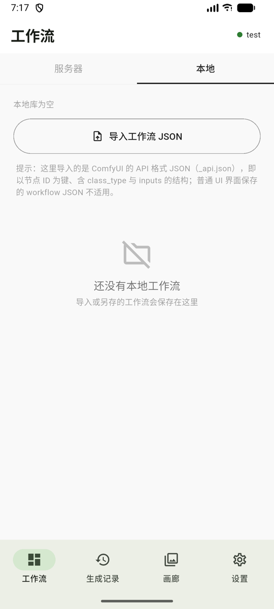
</p>

<p align="center"><i>左：服务器段（按 API / UI 格式分组）　右：本地段（自己的资产 + 导入入口）</i></p>

### 5.3 参数配置面板

把节点参数挑出来、变成手机上的表单。进入方式：首页点击一个**未配置**的工作流，或在任何卡片菜单里选「重新配置节点」。

**分两层，各干一件事**

- **主视图只放你已经放进表单的参数**：顶部一行「已放进表单 N 项（共 M 项）」，下面**一个节点一段**的卡片——段内一行一项：别名 + 它属于哪个节点与当前值，行尾的 × 把它移出表单。**长按任意一段可整段拖动排序**，顺序会保存，运行页的卡片顺序跟着变。改名、移出、排序都只影响手机上的表单，不动工作流本身。
- **「添加参数」进全量列表**：所有参数一个不少地收在这一层，按**用途分段**（提示词 / 采样 / 画面尺寸 / 模型与权重 / 精细控制 / 其余节点），段内按节点分组、可折叠。搜索、批量展开折叠、节点内全选都住在这层。

**它做了什么**

1. 遍历工作流的每个节点，按**内置规则表**判断该节点有哪些参数值得暴露。
2. 定类型：优先看**服务器节点说明书**（`/object_info`）——是下拉、开关还是数值由它决定；取不到说明书时按参数名/参数值推断，并在页面顶部明确提示。
3. 跳过**连线引用**（形如 `["节点id", 0]` 的值）——那不是给你填的。
4. 已选中的进主视图，其余留在「添加参数」页——**收录范围不裁剪**，没被规则收录的节点，它所有能填的参数也会列出来（社区自定义节点、`LoadImage` 的上传框都靠这条兜底覆盖）。

**同名节点，靠连线分清谁是谁**：工作流里有两个 `CLIPTextEncode`（正向、负向提示词）时，添加参数页的卡片下方会多一行说明，写明它**连到哪个节点的哪个输入**（如 `连到 K采样器 · positive`）。模型 / LoRA 加载类也一样看连线（装的是哪个文件，卡片里那行参数就写着当前值）。节点名用的是 ComfyUI 自己的节点标题、输入名用的是工作流里的参数名，**两个都只读不译**；一个输出接到好几处时先写第一处、再注明「等 N 处」，完全没有下游的节点不显示这行，不硬猜。

**识别范围**：规则表按「用途」分组，而不是罗列类名（同一个功能在不同机器上的类名不一样）：

| 分组 | 覆盖的节点 |
| --- | --- |
| 采样器 | `KSampler`、`KSamplerAdvanced`、`SamplerCustom(Advanced)`、`BasicScheduler`、`KSamplerSelect` |
| 文本 / 提示词 | `CLIPTextEncode`、`Text Multiline`、`Text box`、`String Input`、`Text Input`、`PrimitiveStringMultiline`、`Text Concatenate` |
| 尺寸 / 放大 | `EmptyLatentImage`、`EmptySD3LatentImage`、`EmptyFluxLatentImage`、`LatentUpscale(By)`、`ImageScaleBy`、`ImageUpscaleWithModel`、`UpscaleModelLoader` |
| 模型加载 | `CheckpointLoaderSimple`、`UNETLoader`/`UnetLoaderGGUF*`、`CLIPLoader`/`CLIPLoaderGGUF`、`VAELoader`、`CLIPVisionLoader` |
| LoRA / 补丁 | `LoraLoader`、`LoraLoaderModelOnly`、`ModelPatchLoader` |
| ControlNet | `ControlNetLoader`、`ControlNetApplyAdvanced`、`SetUnionControlNetType` |
| IPAdapter | `IPAdapter`、`IPAdapterFaceID`、`IPAdapterNoise`、`IPAdapterUnifiedLoaderFaceID`、`IPAdapterInsightFaceLoader` |
| 换脸 | `ReActorFaceSwap` |
| 去背 / 掩码合成 | `RMBG`、`FeatherMask`、`ImageCompositeMasked` |
| ControlNet 预处理器 | `DWPreprocessor`、`DepthAnythingV2Preprocessor`、`DensePosePreprocessor`、`CannyEdgePreprocessor`、`TilePreprocessor`、`HEDPreprocessor` |

- **规则里的候选名单只决定「默认勾谁」，不裁剪列表**：例如 ControlNet 预处理器默认只勾 `resolution`、`RMBG` 默认只勾模型/灵敏度/处理分辨率；同一个节点的其余参数照样列在「添加参数」页，只是默认不勾——想调随时能勾上。宁可多列几项让人自己勾，也不让参数压根看不见。
- **没收录的节点不会被丢掉**：兜底规则会把它**所有能填的参数**都列出来（连线引用自动跳过），不用改一行代码——但**默认只勾上高频参数那几个**，其余要你手动加，不会一下塞满表单。
- **代价是兜底不区分节点复杂度**：参数极多的节点——实测`ModelMergeQwenImage` 68 个、`ModelMergeFlux1` 65 个（按块合并，一块一个参数）——没有专门的收窄名单，会一次性列进「添加参数」页。不过这类节点默认只勾选高频参数，主视图不会一下多出几十项。
- **强制类型**：`denoise`、`strength_*`、`mask_blur` 等在 JSON 里常常写着整数（`"denoise": 1`），但语义是小数的参数会被强制成小数，否则手机端只能输入整数。
- **默认勾选分三种情况**：① 规则指定了默认项（如 `ControlNetApplyAdvanced` 的 `strength`）→ 只勾这几个；② 规则既没写默认项、也没写候选名单 → 该节点的参数**全部勾上**（能进规则表的都值得在手机上调），不需要的你手动取消；只写了候选名单的规则 → 只勾名单里那几个；③ **没收录的节点 → 只勾高频参数表里的那几个**（种子、提示词、图片、步数、CFG、采样器、调度器、宽高、生成数量、各类模型名），其余等你手动加。

**「添加参数」页里的批量操作**（配置项多的时候很好用）

| 控件 | 作用 |
| --- | --- |
| 搜索框（页面最上） | 按参数名、别名或**节点类名**过滤；**命中哪个参数就只显示哪个参数**，并自动展开命中的分组 |
| 计数（如 `17/18 项已选`）与一键展开 / 折叠 | 计数一眼看出暴露了多少参数；展开折叠**不动勾选状态** |
| 卡片头部的全选 / 取消全选图标 | 只作用**本卡片**，与展开热区分开 |

**别名默认值**：先看内置别名表（"采样步数""CFG 强度""随机种子"这类）；**该节点只有一个参数时**才用你在 ComfyUI 里给的节点标题（例如"基础设定"）；其余一律用服务端真实参数名（`type`、`device` 这种）。多参数节点不用节点标题——三个参数全叫「加载CLIP」等于没名字。别名是**你自己保存下来的内容**，不随界面语言翻译。

**「重新解析」按钮**：服务器工作流更新后，点它按当前结构重新提取参数：**新参数会补进来、工作流里已经没有的参数会消失，而你起的名字与勾选会保留**（刚改完还没保存的别名也算）。参数类型与当前值一律以新解析为准。

<p align="center">
  
  &nbsp;
  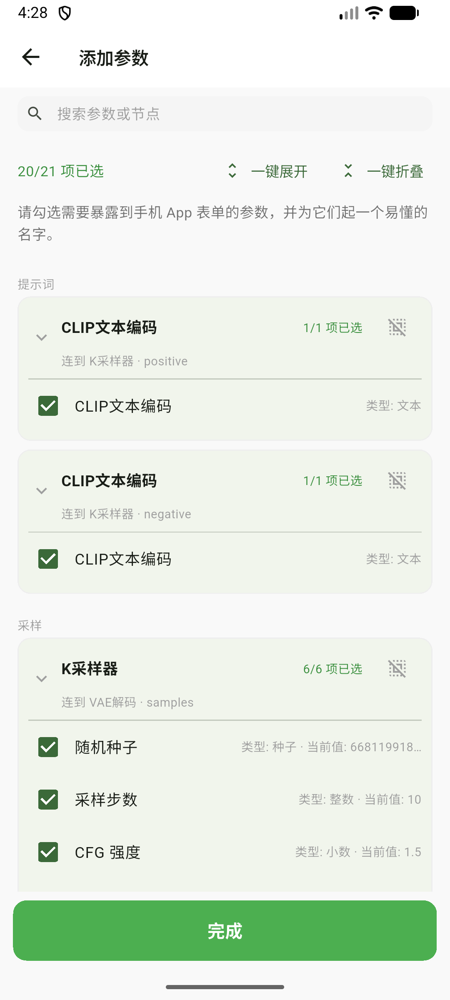
</p>

<p align="center"><i>左：主视图只放已放进表单的参数，行尾可移出　右：「添加参数」页全量按用途分段，同名节点靠连线说清连到谁</i></p>

> 配置保存后自动进入运行页；运行页右上角齿轮可随时回到配置面板，两者互相替换、不堆叠页面。

### 5.4 运行页

填参数、下发任务。按你配置的类型渲染对应控件：

| 类型 | 控件 | 说明 |
| --- | --- | --- |
| 文本 | 多行输入框 | 提示词等 |
| 种子 | 数字输入框 + **随机按钮** | 沿用工作流原值，不擅自替你随机；原值缺失时才自动生成一个 |
| 整数 / 小数 | 数字输入框 | 步数、CFG、denoise 等 |
| 滑块 | 滑块 + 可编辑数值框 | 只有**档位不超过 100** 的数值参数才会变成滑块——实际就是 `denoise`、`start_percent` 这类 0–1 区间；步数是 9999 档、CFG 是 1000 档、宽高按 64 步进，都远超这个上限，一律用输入框（滑轨只有几十像素宽时，拖 1px 跳过上百级反而没法用） |
| 下拉枚举 | 下拉框 | 采样器、调度器、模型名等（见下方"取真选项"） |
| 开关 | 开关 | 布尔参数 |
| 图片 | 图左、操作右的卡片 | 左侧缩略图**点一下看大图**（可缩放），右侧是文件名、来源标签和两颗按钮：「选择图片 / 更换图片」从手机里选，「从服务器选」直接挑服务器上的图。来源会写清楚：本地 · 待上传 / 服务器 · 输入目录 / 服务器 · 输出目录 |

> **尺寸卡**：`EmptyLatentImage` 这类空画布节点的宽高与张数不是普通数字框，而是一张**尺寸卡**——比例（如 1:1、16:9）、长边档位（768 / 1024 / 1280 / 1536）、张数步进器，宽高按 64 对齐，也可以自己填。

参数按节点分组，默认全部展开：点节点卡的头部可以单独收起，卡片多的时候右上角还有**「展开与折叠」菜单**，一键全展开 / 全折叠。同一节点里相邻的成对参数（宽/高、步数/CFG、两个 LoRA 强度等）在屏幕够宽时会**并排两列**，窄屏自动回到单列。

底部是「立即生成」；右边那个窄按钮 **AI** 打开提示词助手，**长按任意参数名**也能直接打开并把该参数预填成写入目标（详见 [5.11](#511-提示词-ai-助手)）。

**下拉里的选项是服务器真实的**：打开运行页时 App 会按参数所属的**节点**向服务器 `/object_info` 问一次，凡是下拉类参数都会拿到服务器上真实存在的选项——模型（Checkpoint / UNET / CLIP / VAE / LoRA / ControlNet）、采样器、调度器是典型，第三方节点的枚举（如 `type`、`device`、`bit_depth`）同样会取。电脑上新装了模型，点右上角刷新即可拿到。

一个例外：**图片上传参数刻意不取**（否则会变成一串服务器文件名，就传不了新图了）。另一个边界：**提交前的拦截只在模型与采样器类键上生效**——这类值如果服务器上没有，会标注出来并拦下，不让你发出必然失败的任务；其余下拉即使值不在服务器选项里也不拦。没连上服务器或没问到时，退回「只有当前值」，跟以前一模一样。

**点「立即生成」会发生什么**

1. 校验当前工作流数据就绪且归属正确（防止提交错工作流）。
2. **服务器侧检查**：服务器不认识这个节点、或模型 / 采样器的值在服务器上找不到，会在这里拦下并说明原因，不发无谓的请求。
3. 处理图片参数（三种来源分别对待）：从手机新选的图先 `POST /upload/image` 上传；从服务器目录选的图**原样提交**（值里带 `[output]` 这类目录注解，不用上传）；没动过的沿用工作流里的原图，也不会覆盖你改过的其它图片参数。
4. 深拷贝工作流 JSON，把表单值写回对应节点的 `inputs`。
5. `POST /prompt` 下发任务。
6. 成功后：**固化一份工作流快照**、写入生成记录、跳到「生成记录」Tab。

**失败会明确告诉你原因**，而不是一句"提交失败"：网络超时、HTTP 错误码，以及服务器返回的 `node_errors`（会列出出错的节点 ID）。

**数值填错也不会静默变空**：提交前逐个 `num.tryParse`，解析失败时回退成工作流里的原值（种子例外，取不到原值时回退 `0`），而不是把 `null` 塞给服务器。另外，服务器说明书里有 min/max/step 的参数，超出范围时控件下方会给出红色提示——**只提示、不拦提交**，因为某些工作流本就故意越界。

<p align="center">
  
</p>

<p align="center"><i>运行页：按类型渲染控件，底部固定「立即生成」</i></p>

### 5.5 任务跟踪

任务共五种状态，进度通过 WebSocket 实时回推：

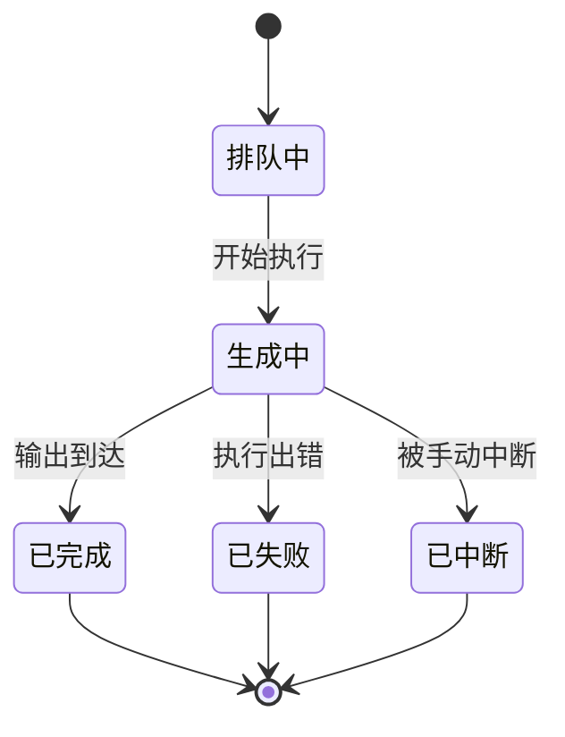

| 状态 | 触发 | 展示 |
| --- | --- | --- |
| 排队中 | 刚提交，还没轮到 | 橙色 + "等待执行…" |
| 生成中 | 收到执行事件 | 橙色 + 当前节点名 + 百分比进度条 |
| 已完成 | 收到输出 | 绿色 + 缩略图 |
| 已失败 | 服务器返回错误 | 红色 + **具体错误原因** |
| 已中断 | 被中断 / 服务器查无此任务 | 灰色 |

卡片第三行还会写更具体的**阶段**：等待执行 / 任务开始 / **命中缓存**（服务器直接复用了上次的结果，没真跑）/ 处理中（带节点名与百分比）/ 生成成功 / 执行出错（可带服务器原文）/ 任务已被中断 / 未在服务端找到该任务 / 结果数据解析失败。与状态本身同义的阶段不重复显示。

**手动停止**：排队中 / 生成中的任务，记录卡片上会出现**停止按钮**，点了先弹一次确认（已经算出来的进度会丢）。优先走 ComfyUI 的按任务取消接口（`/api/jobs/{id}/cancel`），服务器太老不支持时自动降级，照样能停。万一停不掉（离线或服务端拒绝），提示条上会给一个「仍要删除」的出口，免得这条记录永远卡在“生成中”。

**进度从哪来**：WebSocket（`ws://<服务器>/ws?clientId=…`）实时回推，能显示"正在跑哪个节点"以及百分比；节点名会优先用你配置面板里保存的标题，而不是裸的节点 ID。

**崩溃或断线后不会卡死**：App 会主动向 `/history` 与 `/queue` 查询，把卡在「排队中 / 生成中」的任务纠正成真实终态；既不在历史也不在队列的，判定为「已中断（服务器可能已重启）」，避免永久转圈。触发时机有四个：**连接建立成功**、**从后台回到前台且确有进行中的记录**、**在生成记录页点右上角刷新手动对账**，以及**停止任务时**。对账只处理属于当前服务器的任务（早期没有记录归属的旧数据按"属于当前"处理），不会把别的服务器上正在跑的任务误判成已中断。

**切到别的 App 再回来，进度也不会停在旧值**：Android 可能在后台静默掐断 WebSocket（半开连接，不触发断线回调，自动重连不会启动）。回到前台时 App 会重建连接并对账一次——只在确实存在"进行中"记录时才发请求，空闲时不会打扰服务器。

### 5.6 生成记录与再次运行

每条记录是一张紧凑卡片：左侧状态色条与缩略图（多图会显示角标数字），中间是标题、状态与时间；有信息量的阶段说明（如服务器重启导致的中断）单独一行。**再次运行**固定在卡片右侧；进行中的记录该位置是**停止按钮**（此时没有删除），其余记录是**删除**。删除有二次确认，且只在记录确实有本地图片时才让你二选一——**仅删除记录**（保留画廊里的图片）或**同时删除画廊图片**（不可恢复）；删掉时卡片会原地收拢消失，**没有撤销**（删了就是删了）。快照已删的记录再次运行会置灰提示原因，而不是静默失败。

**搜索与状态筛选**

- 搜索框在列表上方通栏，**实时过滤**（记录上限 50 条，不需要防抖）。
- 匹配范围：工作流的**展示名** + 本次运行**填入的参数值** + 参数**别名**（别名要能通过快照反查，快照被删就自动降级成只匹配值）。
- 多个关键词按空格分词，要求**全部命中且落在同一个字段**——避免"正面提示词里有猫、负向里有窗台"被误判成同一条。
- **数值不参与匹配**：搜 `7` 不会因为某条记录里 `cfg=7` 而命中，否则全是噪音。
- 大小写不敏感；关键词为空时原样返回全部。
- 命中时在卡片上显示**命中摘要**，直接告诉你为什么匹配（例如 `CLIP文本编码: …human…`）。靠工作流名命中的不再重复展示摘要。
- 状态筛选条 5 项：全部 / 进行中（排队 + 生成合并） / 已完成 / 已失败 / 已中断，可与搜索叠加。
- 空态分两条文案：「没有匹配的记录」和「本来就没有记录」，不会让人误以为记录丢了。

<p align="center">
  
  &nbsp;
  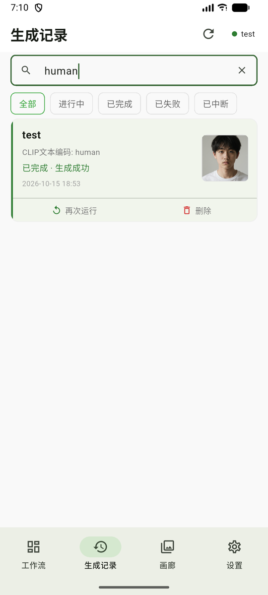
</p>

<p align="center"><i>左：默认视图（状态筛选条）　右：搜 "test" 按工作流名命中全部 6 条</i></p>

**再次运行**——这是本 App 最实用的能力之一：

- 每次运行都会自动固化一份**快照**（工作流 JSON + 当时的参数配置），所以任何历史记录都能还原出当时的表单。
- 点「再次运行」后，表单结构按快照还原、**参数按当时填的值预填**（包括提示词、种子等原值，不擅自随机）。图片参数也在内：上次实际用过的图会填回来（本地选的图在上传后会记成服务器上那一份）；两张里只换一张时，另一张**不会被悄悄换回**工作流原图。
- 若你后来改了暴露配置，导致某些旧参数在当前表单里已不存在，会明确提示"N 项因配置变更未能套用"，而不是静默丢弃。
- 若当前连接的服务器**不是**当初运行的那台，会先弹窗警告（模型/插件可能不同，可能报"模型不存在"），由你决定是否继续。更早版本的记录没有记录所属服务器，也会走这一步确认（两侧都显示为「未知服务器」）。

**看大图**：点缩略图进全屏查看器——图片支持双击放大（最大 6 倍，放大时不会误翻页），顶部写着当前位置（`1 / 5`）。底部是一条**这次实际喂进去的参考图**缩略条：点一下切过去、按住临时对比（提示条会写「输入 1 / 2 · 松开回到出图」），松手回到出图；再下面是「保存到本地」。参考图已被服务器清理、或当初那台服务器已被移除时，会直接说明取不到，不会静默失败。

> 删除记录**不会**删除快照——快照可能被其它记录引用。快照的清理在设置页手动进行。

### 5.7 工作流快照

再次运行的地基。

| 问题 | 答案 |
| --- | --- |
| 快照是什么 | 某次运行时固化下来的「原始工作流 JSON + 当时的节点暴露配置」 |
| 为什么需要它 | 与服务器解耦——即便服务器上那份文件被删或被改，历史记录依然能凭快照重跑 |
| 什么时候生成 | 每次成功下发任务时（内容没变则复用同一份快照，只同步最新配置） |
| 改配置会多出快照吗 | 不会。快照按**工作流内容**去重，改暴露配置不会让已有记录引用失效 |
| 怎么清理 | 设置 → 工作流快照，显示每份快照被多少条记录引用，可手动删除 |

<p align="center">
  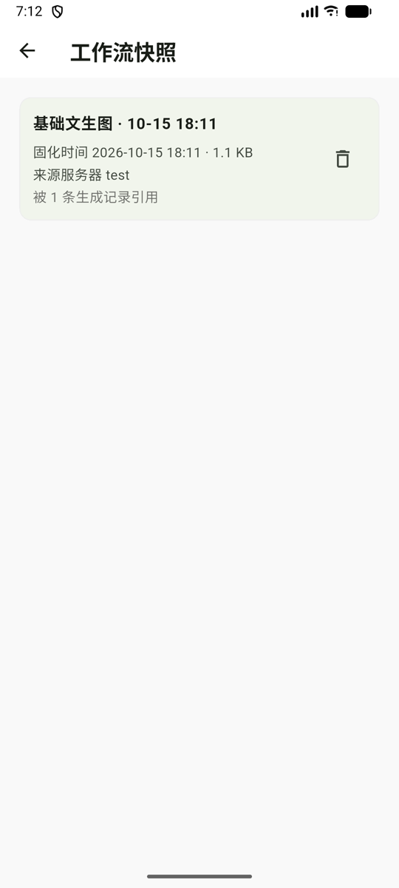
</p>

<p align="center"><i>快照列表：固化时间、体积、来源服务器、被多少条记录引用</i></p>

### 5.8 画廊与保存到相册

**画廊**：独立 Tab，三列网格浏览所有已下载到本机的生成结果（顶部可下拉刷新，右上角也能刷新；还没有结果时给出空态说明）。点开是大图查看器（顶部显示当前位置如 `1 / 5`），支持双指缩放、**双击放大**、左右滑动切换、删除单张（有二次确认）；查看器上还有分享入口，**目前尚未开放**，点击会提示"即将支持"。

如果这张图能反查到当时那条记录、并且那条记录的快照还在，查看器里会多一个**「再次运行」**：用当时的工作流重跑一遍。它不是「复现这张」——出图自带随机性，所以点之前会明确提示这一点。

底部还有那条参考图缩略条（这张图当时喂进去的图）：**点一下**用单图查看器停住看，再点画面关掉；**按住**临时看，松手回到当前出图。

> 画廊网格目前只渲染图片。视频（mp4 / webm / mov）只在**生成记录的查看器**里播放。

**保存逻辑**：

- 图片优先读取已下载的本地文件（不重复下载）；图片到手之后才请求系统相册权限——被拒绝会提示，不会静默失败。
- PNG 会先问你：**带工作流原图**（保留 ComfyUI 元数据，可拖回 ComfyUI 复现）还是**普通图片（剔除信息）**。
- 视频（mp4/webm/mov）写入临时文件后保存到相册。

**自动下载**：生成成功后，App 会把输出媒体下载到本机画廊目录，**保留原始 PNG 元数据**，所以离线也能看图、也能保存到相册。

<p align="center">
  
  &nbsp;
  
  &nbsp;
  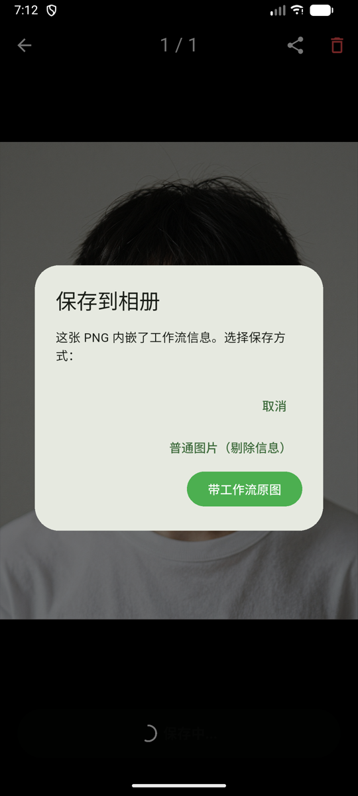
</p>

<p align="center"><i>画廊网格 → 大图查看器 → 保存到相册时的两种选择</i></p>

### 5.9 设置中心

| 分组 | 入口 | 作用 |
| --- | --- | --- |
| 连接 | **服务器连接** | 增删改服务器、测试连接、切换启用 |
| 连接 | **AI 服务** | 提示词助手用的 AI 供应商：内置 DeepSeek 预设，也能填任意 OpenAI 兼容地址；可存多套、指定当前、测连接（见 [5.11](#511-提示词-ai-助手)） |
| 数据 | **工作流存储** | 汇总本机保存的所有工作流，按「本地资产 / 解析缓存」分组，显示占用空间；本地资产可删除，解析缓存只能清除 |
| 数据 | **工作流快照** | 查看所有快照、被引用次数、来源服务器，手动删除 |
| 通用 | **界面语言** | 跟随系统 / 简体中文 / English，选择记在本地 |
| 通用 | **外观** | 跟随系统 / 浅色 / 深色，选择记在本地；深色是整套语义色，不是简单反色 |
| 通用 | **震动反馈** | 6 类操作分别开关：切换标签页 / 勾选参数 / 拖动排序 / 折叠卡片 / 提交成功 / 长按看图，也可一键全开 / 全关 |
| 通用 | **GitHub 访问令牌** | 可选。私有仓库检查更新需要它；公开仓库留空也能用，只是匿名接口的请求限额更低 |
| 通用 | **关于** | 版本号、检查更新 |

**关于界面语言**

- 默认跟随系统；系统语言不是中文或英文时回退**中文**，也可以在设置里手动锁定。
- 持久化数据里**不存任何界面文案**：任务状态存枚举名（`queued`/`running`/`completed`/`failed`/`interrupted`），节点名、服务端错误原文这类动态内容单独存，旧版本残留的中文数据在读取时自动迁移。
- 因此切换语言不会影响历史记录：标题会按当前语言重新显示，参数值、图片、快照全部原样。
- 唯一不翻译的是**你自己命名/配置的内容**：工作流标题、参数别名、模型名与节点名（ComfyUI 里本来就是英文）。

**关于外观**

- 默认跟随系统，也可以锁定浅色 / 深色，选择同样记在本地。
- 深色不是把浅色反一下：整套语义色（卡片、边框、状态色、输入框）都单独定过；冷启动底色也跟着明暗走，不会先闪白再变深。
- 唯一的例外是看图页：全屏查看器固定纯黑底，跟主题无关。

**关于震动反馈**

- 6 类动作可分别关掉、互不影响，也可以一键全开 / 全关；新装默认全开。
- 管的是 App 自己触发的震动（切页、勾选、拖动、折叠、提交、长按看图）；输入框里选词这类系统自带的触感不在此列。

<p align="center">
  
  &nbsp;
  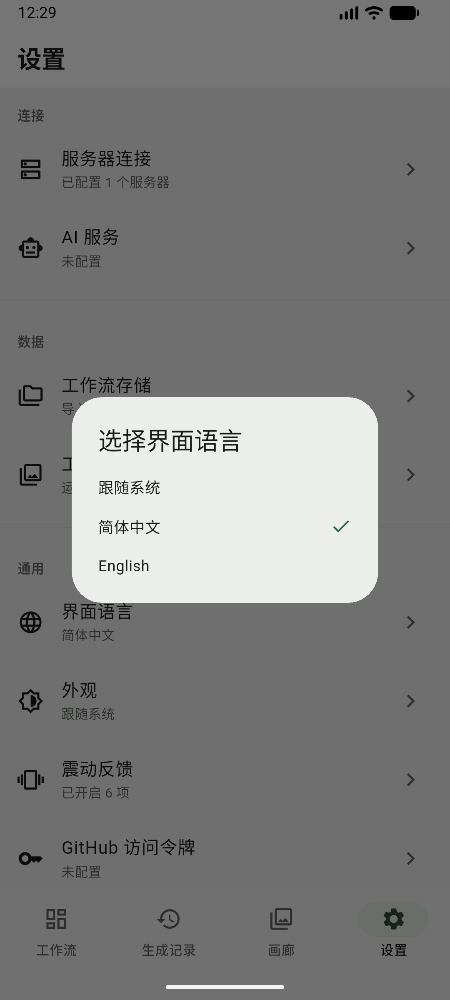
  &nbsp;
  
</p>

<p align="center"><i>设置中心 → 语言选择 → 切到英文后的同一个页面</i></p>

### 5.10 应用内更新

- **手动检查**（不做后台自动检查）：关于页点「检查更新」，向 GitHub Releases 查询最新版本，与当前版本比对。
- 有更新时展示版本号、包大小、Release 说明（会自动清洗 Markdown 标记），点「下载并安装」走进度条下载 APK，然后唤起系统安装界面。
- **私有 / 公开仓库都支持，不需要改代码**：
  - 没配令牌时走匿名请求。仓库**公开**就能直接查到更新并下载。
  - 仓库**私有**时匿名请求会被 GitHub 一律回 404（不是 403），需要在设置里填一个对该仓库有 Contents 读取权限的只读令牌。令牌**只保存在本机**，不上传。
  - 令牌过期或被回收时，App 会**自动降级成匿名**再试一次——所以仓库从私有转成公开后，老用户不手动清令牌也能继续检查更新（查询和下载都会自动兜底）。
- **非 Android 平台不支持应用内安装**：会告诉你发现了新版本，但请到 Release 页面手动下载。

### 5.11 提示词 AI 助手

**这一节是可选的，需要你自己的 AI 服务。** App 不提供模型、也不代付费用：先去 **设置 → 连接 → AI 服务** 配一个 OpenAI 兼容的服务（内置 DeepSeek 预设，也可以填自己的地址、模型与 Key），配好才用得上。没配不影响其它任何功能。

**两个入口**

- 运行页底部「立即生成」右边的 **AI** 按钮；
- **长按任意参数名**：直接打开抽屉，并把那个参数预填成写入目标（文本参数）或参考输入。

**一次用下来的流程**

1. **输入**（可多选）：把要参考的节点勾进来——提示词这类文本，或者图片（最多 4 张）。
2. **输出**（单选）：选一个**文本参数**作为写入目标。
3. 写一句要求，或挑一个模板（自定义 / 看图写词 / 改写）——模板只是帮你预填一句话，不是另一套模型。
4. 点「生成」，随时可以停；看图写词会先把原图读上来（底部会显示「正在读取原图 x/y」）。
5. 结果是一张**建议卡**：显示字数变化，可以复制，也可以直接写入。
6. 写入后表单里就是新文本，**随时能撤销**回到写入前。

**写入有一整套闸门**（这也是它敢直接改表单的原因）：

- 只写**文本参数**——图片、数值、下拉、开关一律不碰；
- 只写你选定的**那一个目标**：模型顺手给别的节点提的改动会被拒绝；
- 这期间工作流或参数变了（节点没了、参数名对不上）→ 拒写并说明原因；
- 单条超过 8000 字 → 拒写；
- 上下文有预算（约 6000 字）：超了先丢模型信息、再丢最旧的文本，不会把你正在改的那段悄悄截掉。

**隐私与费用**

- Key 明文存在本机应用私有存储里，**只随请求发往你自己填的地址**，不经任何中间服务器。
- AI 会话不落盘：关掉抽屉就没了，只有你点「写入」的那段文本会进表单。
- 调用产生的费用由你的 AI 账号承担。

**取不到图或连不上**：看图写词要能读到服务器上的原图（图被删了就取不到）；AI 服务失败会按原因分开说（密钥无效 / 地址或模型名不对 / 请求太频繁 / 等太久……），不会只丢一句"失败"。

<!-- 截图占位：AI 抽屉（输入 / 输出 / 要求）与 AI 服务配置，待补
     建议文件名：docs/screenshots/{zh,en}/15-ai-sheet.png、16-ai-service.png -->

---

## 六、功能之间的关联逻辑

### 数据是怎么流动的

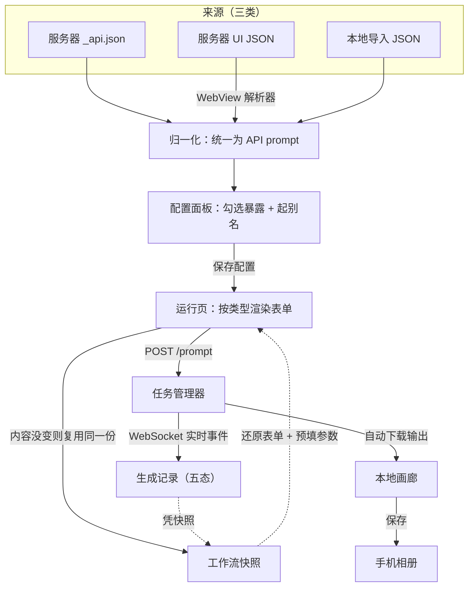

### 三条来源 → 一个入口

三条路径最终都归一成**同一种结构**（节点 ID → `{class_type, inputs}`），因此配置面板和运行页**只需要一套逻辑**，不用为每种来源各写一遍。这也是为什么 UI 格式必须先解析、而不能直接跑。

### 快照把"运行"与"记录"解耦

```
一次运行 ──▶ 生成记录（快照 id + 当次参数 + 状态 / 进度 / 输出 / 所属服务器）
        └──▶ 快照（工作流 JSON + 节点配置；同一份工作流内容只留一份）

删除记录 ──▶ 快照还在（可能被别的记录引用）
再次运行 ──▶ 拿快照还原表单 + 拿记录的参数预填
```

这样即使服务器上那份工作流已改、已删，"再次运行"依然成立——**你的历史记录不会因服务器变动而失效**。

### 三段归属，三种生命周期

| | 服务器工作流 | 解析缓存 | 本地资产 | 快照 | 生成记录 | 画廊图片 |
| --- | --- | --- | --- | --- | --- | --- |
| 存在哪 | 服务器 | 本机 | 本机 | 本机 | 本机 | 本机文件 |
| 会不会因服务器变动失效 | 会 | 会（提示重新解析） | 不会 | **不会** | 不会 | 不会 |
| 能不能删 | 不提供 | 只能"清除" | 能 | 能 | 能 | 能 |
| 上限 | 无 | 无 | 无 | 无（设置页可看占用） | 最近 50 条 | 无 |

### 多服务器下的边界行为

- 切换服务器 → 工作流列表清空（本地记录、画廊、本地工作流都不受影响）。
- 任务会记录**所属服务器**；对账只处理属于当前服务器的任务，不会把别的服务器上正在跑的任务误判成"已中断"。
- 再次运行时若服务器不一致 → 弹窗警告后由你决定。

---

## 七、常见问题与排查

| 现象 | 原因与处理 |
| --- | --- |
| 顶部徽标一直是红的 | HTTP 探测或 WebSocket 其一未通。检查服务器是否启动、地址端口是否正确、手机与服务器是否在同一网络。点徽标进配置页，用"测试连接"逐个验证主/备地址 |
| 服务器段提示"未找到工作流" | `userdata/workflows/` 下没有 JSON 文件。在电脑上用 ComfyUI **保存过一次**工作流即可（**不需要插件**）；装了 AutoSaveAPI 会额外多出一份 `_api.json` |
| UI 工作流解析失败 / 超时 | 解析要加载完整的 ComfyUI 前端，慢设备上可能要十几秒。确认手机能正常打开该服务器的网页版 UI；仍失败可点"重新解析"再试 |
| 解析成功却提示"没有可动态修改的参数" | 这个工作流的参数**全是连线引用**（或值的类型无法识别成可填控件）。点配置面板右上角「重新解析」再试；仍不行说明它确实没有适合在手机上填的参数 |
| 卡片变黄提示"内容已更新" | 服务器上的工作流内容变了，旧参数可能与新结构对不上。点进去重新确认配置 |
| 提交时报 HTTP 400 并列出错误节点 | 服务器校验不通过（常见：模型名不存在、节点类型缺失）。按提示的节点 ID 回电脑检查该节点的输入 |
| 任务一直卡在"生成中" | 断线/后台期间错过了终态事件。点生成记录页右上角的刷新按钮手动对账（连接建立成功、从后台回到前台且确有进行中记录时也会自动对账） |
| 搜索搜不到某条旧记录 | 三种可能：① 更早版本的记录没有保存"本次填入的参数"，只有工作流名可搜；② 参数**别名**要靠快照反查，快照在设置页被删过就自动降级为只匹配值；③ **数值不参与匹配**，搜 `7` 不会命中 `cfg=7` |
| 「添加参数」页搜索后列表空了 | 搜索是**按参数过滤**的：命中哪个参数就只显示哪个参数，没命中就显示"没有匹配的参数"。关键词必须出现在参数名、别名或节点名里 |
| 切到英文后参数别名还是中文 | 别名是配置时保存下来的内容，属于你的自定义数据，不随界面语言翻译。直接在配置面板改成想要的名字即可 |
| 检查更新提示"仓库不可访问" | 仓库确实是私有的，或令牌对该仓库没有 Contents 读取权限。App 遇到令牌失效会**自动改用匿名请求重试一次**——匿名也被拒，说明问题在仓库权限本身，清掉本地令牌不会变好 |
| 保存图片到相册失败 | 首次需要授予相册权限 |
| 点了 AI 按钮没反应 / 只提示先配置 | 还没配 AI 提供商：设置 → 连接 → AI 服务（选 DeepSeek 预设的话只需再补一个 Key） |
| AI 提示「无法写入」 | 四种原因之一：目标不是文本参数、不在这次选定的目标里、工作流或参数刚变过、单条超过 8000 字；建议卡上会写明是哪一种 |
| 从服务器选图只列出「生成过的图」 | 这台服务器的内部列目录接口不可用，已自动降级成从生成记录反推；选图页顶部会说明 |
| 种子参数没有骰子按钮了 | 旧配置把它的控件类型存成了「数字」。去配置页点一次「重新解析」（现在会保留你起的名字与勾选），按钮就回来 |

---

## 八、已知限制

以下为当前版本的真实边界，不是 bug：

- **图片参数不进下拉**：其余下拉（包括第三方节点自己的枚举）都会按其所属节点向 `/object_info` 取真实清单；图片参数走的是专门的选图卡片（手机相册 + 服务器目录两条路）——塞进下拉只会变成一串文件名，还没法传新图。另外，**提交前拦截只在模型与采样器类键上生效**，其它下拉的值即使不在服务器选项里也不拦。
- **下拉取真选项依赖当次连接**：没连上服务器、或请求拿不到时，下拉自动退回"只有当前值"，跟以前完全一样，不会报错。模型清单是进页面时取的，电脑上新装了模型要点一下右上角的刷新。
- **数值参数不做强制的范围拦截**：会取服务器的 min/max/step（档位 ≤100 时渲染成滑块），超出范围只给红色提示、不拦提交；拿不到说明书时退回自由输入框。填了非数字会回退成工作流原值（不会提交空值）。
- **参数极多的节点没有收窄规则**：`ModelMergeQwenImage`、`ModelMergeFlux1` 这类按块合并的节点，实测单节点可达 60~68 个参数，只有兜底、没有专门的收窄名单，会一次性列进「添加参数」页（默认只勾高频参数，主视图不受影响）。
- **图片参数记的是「服务器上的哪张图」**：值里带目录注解（如 `xxx.png [output]`），input 与输出目录都能指；但只要那张图在服务器上被删了（清输入目录、清输出、换机器），这条记录里的引用就失效——记录本身和已下载到本机的图片不受影响。
- **从服务器选图靠的是官方「内部接口」**：优先用它列目录，官方明说不保证跨版本稳定；用不了会自动降级成从生成记录反推，那时只能挑「生成过的图」，选图页顶部会说明。
- **AI 助手需要你自己的 AI 服务**：不配就用不了。Key 明文存在本机；各家服务对图片、上下文长度、限流的支持不一样，报错会按原因分开说。
- **AI 只改文本参数**：图片、数值、下拉、开关一律不动，一次只写一个目标；写出来的内容仍要你自己判断——它可能改得很顺，也可能改坏语气。
- **AI 会话不保存**：关掉抽屉就没了，只有点「写入」的文本会进表单，想留档就自己复制出来。
- **搜索只覆盖最近 50 条记录**：这是生成记录本身的上限，搜索是纯本地过滤、没有索引；记录量级大幅增长后需要重新设计。
- **主要面向 Android**：应用内更新、相册保存、APK 安装均按 Android 实现；其它平台可编译但未做完整验证，检查到新版本时只提示去 Release 手动下载，不提供应用内安装。
- **不做后台自动检查更新**，只在关于页手动触发。

---

## 九、技术栈与项目结构

**技术栈**：Flutter · Riverpod（状态管理）· http · http_parser · web_socket_channel · shared_preferences · file_picker · webview_flutter · video_player · gal（相册）· path_provider · package_info_plus · open_filex · flutter_localizations（多语言）

```
lib/
├── main.dart                 # 入口：注入 SharedPreferences、挂明暗两套主题与多语言
├── theme.dart                # 明/暗两套色板 + BuildContext 语义色扩展
├── utils.dart                # 参数类型推断、哈希、展示名解析、图片来源三态
├── l10n/                     # 文案源（app_zh.arb 为模板，app_en.arb 为英文）
├── models/                   # 数据模型
│   ├── workflow_node.dart    # 节点参数配置（类型/别名/选项/当前值）
│   ├── task_history.dart     # 生成记录（状态枚举 + 阶段 + 快照引用 + 参数快照）
│   ├── task_status.dart      # 任务状态/阶段枚举与旧中文数据的迁移
│   ├── workflow_snapshot.dart# 工作流快照
│   ├── local_workflow.dart   # 本地资产
│   ├── parsed_workflow.dart  # UI 工作流解析缓存
│   ├── ai_provider_config.dart / ai_task.dart  # AI 提供商配置 / 一次 AI 任务
│   ├── workflow_entry.dart   # 展示名公共视图
│   └── release_info.dart     # GitHub Release 信息
├── providers/                # Riverpod 状态层
│   ├── shared_preferences_provider # SharedPreferences 注入点
│   ├── locale_provider       # 界面语言偏好与语言解析规则
│   ├── theme_mode_provider   # 外观偏好（null = 跟随系统）
│   ├── haptics_provider      # 震动类别开关（含新增类别的迁移）
│   ├── ai_settings_provider  # AI 提供商配置（多套 + 当前选中）
│   ├── connection_provider   # 多服务器 + 主备探测（结构化探测结果）
│   ├── workflow_provider     # 工作流列表、内容、内容哈希校验
│   ├── task_manager          # 任务提交、历史持久化、对账、本地画廊化
│   ├── ws_event_provider     # WebSocket 通道与自动重连（3 次上限、递增退避）
│   ├── object_info_provider  # 节点说明书的取数与状态（成功 / 空 / 失败）
│   ├── snapshot_provider     # 快照
│   ├── gallery_revision_provider # 画廊内容变更计数（驱动刷新）
│   ├── local_workflow_provider / parsed_workflow_provider
│   └── update_provider / github_token_provider
├── services/
│   ├── workflow_api_converter # UI→API 转换的脚本与结果校验（纯函数，可单测）
│   ├── workflow_node_parser   # 节点识别规则表 + 参数类型/用途分类判定（纯函数，可单测）
│   ├── node_role              # 同名节点的位置说明（读连线与参数值，纯函数）
│   ├── object_info_service    # /object_info 节点说明书：选项、min/max/step、控件形态
│   ├── submit_check           # 提交前的服务器侧拦截（缺节点 / 缺选项）
│   ├── image_ref              # 图片值解析（文件名 / 子目录 / `[output]` 注解）
│   ├── server_image_service   # 列服务器图片（内部接口优先，/history 降级）
│   ├── param_order            # 配置页分段与拖动排序的纯逻辑
│   ├── throttled_image        # 缩略图并发闸门（3 并发，防止打满服务端）
│   ├── reference_image        # 认出「这次喂进去的参考图」
│   ├── ai/                    # AI 助手：请求 / 载荷组装 / 响应解析 / 取原图 / 写入校验
│   ├── gallery_store          # 本地画廊存储
│   ├── media_saver            # 统一保存到相册入口（含权限请求）
│   ├── png_metadata_stripper  # PNG 元数据剔除
│   └── update_service         # GitHub Releases 查询与下载
├── utils/
│   ├── task_display.dart     # 任务状态/阶段 → 按当前语言生成展示文案
│   ├── task_stop.dart        # 停止任务：官方取消接口与老版本降级
│   ├── task_run.dart         # 「再次运行」的统一入口（记录页与画廊页共用）
│   ├── task_references.dart  # 一条记录实际喂进去的参考图
│   ├── history_search.dart   # 生成记录的关键词搜索与状态筛选（纯函数，可单测）
│   ├── workflow_last_run.dart# 「上次运行时间」的统计
│   └── release_notes.dart    # Release 说明的 Markdown 清洗
└── ui/
    ├── main_screen.dart      # 底部导航壳
    ├── home/                 # 工作流：服务器段 / 本地段
    ├── builder/              # 配置面板 / 添加参数页 / 运行页 / WebView 解析页 / 服务器选图页
    │   ├── ai/               # AI 入口按钮 / 抽屉 / 节点选择器 / 建议卡
    │   └── param_widgets/    # 各类型控件（含空画布的尺寸卡与比例预设）
    ├── gallery/              # 生成记录 / 画廊
    ├── settings/             # 设置中心（语言 / 外观 / 震动 / AI 服务）与各子页
    └── widgets/              # 共用控件：徽标、缩略图与查看器、参考图条、骨架屏、分段标题等
```

**多语言**：文案写在 `lib/l10n/*.arb`，`flutter pub get` 时由 `flutter gen-l10n` 生成 `AppLocalizations`（配置见 `l10n.yaml`）。默认跟随系统，非中英文的系统语言回退中文，用户可在「设置 → 界面语言」里手动选择，选择记在 `comfy_ui_locale`；外观记在 `comfy_ui_theme`，震动开关记在 `comfy_ui_haptics`。

持久化数据里不存任何展示文案：任务状态存枚举名（`queued`/`running`/`completed`/`failed`/`interrupted`），阶段与动态内容（节点名、服务端错误原文）分开存，旧版本的中文数据在读取时迁移。英文界面的实拍截图见 `docs/screenshots/en`。

---

## 十、开发、测试与发布

```bash
flutter pub get
flutter run          # 开发运行
flutter analyze      # 静态检查，提交前应零告警
flutter test         # 单元测试与组件测试（当前 610 个用例全绿）
```

解析、搜索、语言策略这类纯逻辑都抽成了不依赖 `BuildContext` 的纯函数（`workflow_node_parser` / `history_search` / `task_display`），可以直接单测；复杂界面走 widget 测试。

**仓库里的文档与图片**

| 路径 | 内容 |
| --- | --- |
| `README.md` / `README_EN.md` | 中文 / 英文说明（页首可互相切换） |
| `docs/screenshots/zh`、`docs/screenshots/en` | 实机截图（Android 模拟器） |
| `design/app_icon_1024.png` | 应用图标源文件 |

**发布约定**

- 版本号即 APK 的 `versionName`，来自 `pubspec.yaml` 的 `version: X.Y.Z+N`，**必须与 git tag 一致**（如 `v1.1.0`），否则应用内更新会误判。
- 发版流程：改 `pubspec.yaml` → commit → `git tag -a vX.Y.Z -m "<说明>"` → `git push origin main --follow-tags`。
- **tag 一定要用附注形式（`-a`）**：轻量标签推上去时带不出提交信息，CI 页面上的运行标题会回落成 workflow 名（`v1.4.0` 就踩过）。
- CI 只在推送 `v*` tag 时构建并发布 APK；手动触发（workflow_dispatch）**只构建、不产出 Release 资产**。
- Release 构建使用正式签名，永不回退 debug 签名（否则用户无法覆盖安装）。签名配置在本地通过 `android/key.properties` 提供；CI 由 `.github/workflows/release.yml` 用仓库 Secrets 生成。
- 打 tag 推送后，GitHub Actions 会自动构建 release APK 并上传到 Release。

---

## 十一、未来计划

两个方向，**未排期、也不作承诺**，仅供参考：

| 方向 | 要解决什么 |
| --- | --- |
| **接入 RunningHub 云端工作流** | 没有本地显卡、或不想开家里那台机器时也能跑同一批工作流。它提供 ComfyUI 原生兼容的接入方式，目标是把它当成"另一台服务器"来连，尽量复用现有的连接与运行流程 |
| **iOS 支持（只做过调研，未排期）** | 工程骨架与用到的插件都是现成的，真正的门槛在 Apple 侧：局域网明文 HTTP 要单独放行、本地网络与相册权限要写用途说明、必须有 Mac 才能签名打包；"不上架但给别人装"至少需要 $99/年的开发者账号 |

细节与先后顺序都还没定。

---

## 图标

App 使用自定义图标，并按 Android 自适应图标规范输出：背景层铺满 108dp 画布，前景内容位于中央 72dp 安全圆内，因此在圆形、圆角方形、水滴形等不同 launcher 遮罩下都不会露底或被裁切。图标源文件见 `design/app_icon_1024.png`。
