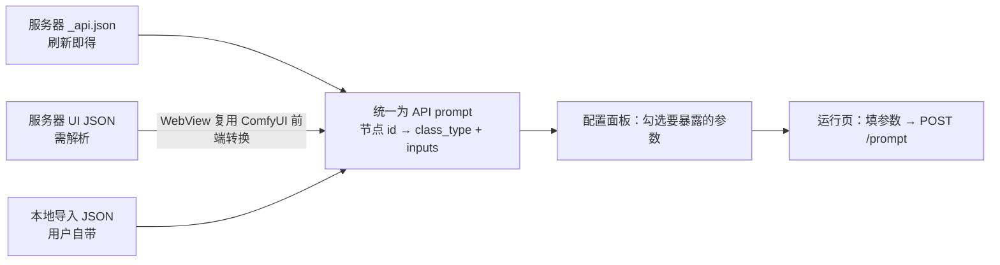
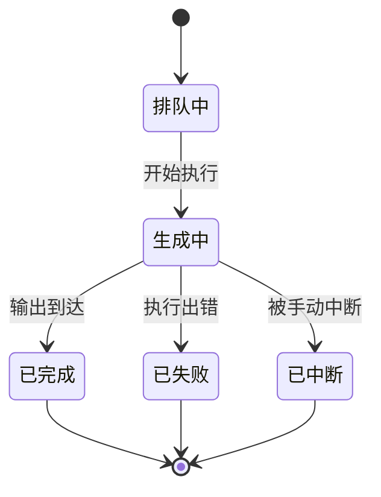
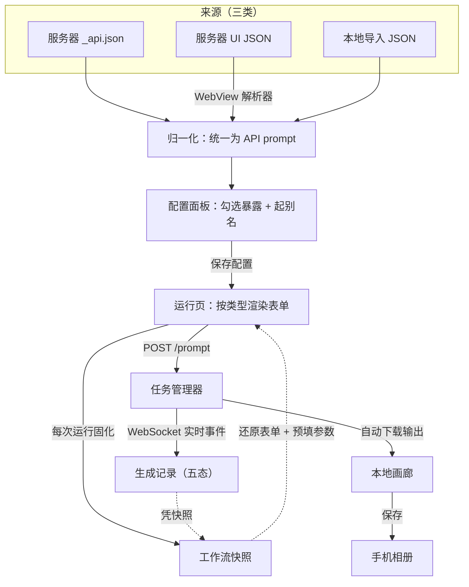

# ComfyUI MobilePocket

**把 ComfyUI 装进手机口袋。**

在手机上浏览服务器里的工作流，把常用参数变成一张可填的表单，点一下就把生图任务下发到 ComfyUI，实时看到进度，出图自动存进本地画廊和手机相册。不用开电脑、不用 SSH、不用记节点 ID。

> 一句话概括：**它是一个 ComfyUI 的"遥控器"——工作流和算力还在你的服务器上，手机只负责挑参数、下任务、收结果。**

---

## 目录

- [一、核心能力速览](#一核心能力速览)
- [二、开始之前：你需要准备什么](#二开始之前你需要准备什么)
- [三、安装与首次连接](#三安装与首次连接)
- [四、界面导览](#四界面导览)
- [五、功能详解](#五功能详解)
  - [5.1 连接管理](#51-连接管理)
  - [5.2 工作流的三条来源](#52-工作流的三条来源)
  - [5.3 参数配置面板](#53-参数配置面板)
  - [5.4 运行页](#54-运行页)
  - [5.5 任务跟踪](#55-任务跟踪)
  - [5.6 生成记录与再次运行](#56-生成记录与再次运行)
  - [5.7 工作流快照](#57-工作流快照)
  - [5.8 画廊与保存到相册](#58-画廊与保存到相册)
  - [5.9 设置中心](#59-设置中心)
  - [5.10 应用内更新](#510-应用内更新)
- [六、功能之间的关联逻辑](#六功能之间的关联逻辑)
- [七、完整使用流程：从零到出图](#七完整使用流程从零到出图)
- [八、常见问题与排查](#八常见问题与排查)
- [九、已知限制](#九已知限制)
- [十、技术栈与项目结构](#十技术栈与项目结构)
- [十一、开发、测试与发布](#十一开发测试与发布)

---

## 一、核心能力速览

| 能力 | 说明 |
| --- | --- |
| 多服务器连接 | 保存多套服务器（家里内网 / 公司外网），每条可设**主地址 + 备用地址**，主的不通自动回退 |
| 三种工作流来源 | 服务器 `_api.json` 直接跑；服务器 UI 格式 JSON **在 App 内解析成 API 结构**再跑；本地 JSON 文件导入 |
| 参数变成表单 | 自动解析节点参数，勾选要暴露的项、起中文别名，运行页生成对应控件（文本/种子/整数/小数/开关/下拉/图片） |
| 实时进度 | WebSocket 回推，显示当前正在执行的节点与百分比；断线自动重连并主动向服务器对账 |
| 五态任务管理 | 排队中 / 生成中 / 已完成 / 已失败 / 已中断，失败时展示服务器返回的具体错误原因 |
| 再次运行 | 每次运行自动固化快照，任何一条历史记录都能凭快照还原当时的表单与参数，一键重跑 |
| 本地画廊 | 出图自动下载到 App 沙盒，**保留原始 PNG 元数据**（可拖回 ComfyUI 复现），支持大图查看与视频播放 |
| 保存到相册 | 可选"带工作流原图"或"剔除元数据的普通图片" |
| 应用内更新 | 手动检查 GitHub Releases，下载 APK 并唤起系统安装（支持私有仓库令牌） |

---

## 二、开始之前：你需要准备什么

### 1. 一台能访问到的 ComfyUI 服务端

App 通过 HTTP 与 WebSocket 和 ComfyUI 通信，因此手机必须能访问到那台机器（同一局域网 Wi-Fi，或已做好内网穿透 / 公网映射）。

App 启动时会请求 `GET /system_stats` 探测连通性，所以服务器需要先启动。

### 2. 想用"在线获取工作流"：装 ComfyUI-AutoSaveAPI 插件

服务器段的工作流列表来自 ComfyUI 的 `userdata/workflows/` 目录。要在里面自动生成可直接运行的 API 格式文件，需要安装插件：

- **ComfyUI-AutoSaveAPI**：<https://github.com/Volitasa/ComfyUI-AutoSaveAPI>

> 注意：该插件是在你**保存工作流时**导出 `_api.json`，不是运行时导出。所以流程是「在电脑上保存一次工作流 → 手机上就能看到并使用它」。

### 3. 两种 JSON 格式，别搞混

| 格式 | 长什么样 | App 怎么用 |
| --- | --- | --- |
| **API 格式**（文件名通常以 `_api.json` 结尾） | 以**节点 ID 为键**、每项含 `class_type` 与 `inputs` | **可直接运行** |
| **UI 格式**（普通 `*.json`） | 顶层是 `nodes` / `links` 数组，是 ComfyUI 界面保存的原始结构 | **需先解析**成 API 结构才能运行 |

好消息是：**UI 格式不用你手动转换**。App 内置了解析器（见 [5.2](#52-工作流的三条来源)），点一下"解析"即可。

---

## 三、安装与首次连接

1. 下载最新版本的 APK 并安装（Android 需要允许"安装未知来源应用"）。
2. 打开 App，进入 **设置 → 服务器连接 → 新增连接**。
3. 填写：
   - **名称**：给自己看的，例如"家里 4090"
   - **主地址**：例如 `http://192.168.1.100:8188`（局域网地址）
   - **备用地址**（可选）：例如外网穿透地址。主地址不通时自动尝试
4. 点**测试连接**验证，然后**保存**。第一个连接会自动启用。
5. 回到**工作流** Tab，顶部状态徽标变绿即表示已连上（徽标同时要求 HTTP 探测成功 **且** WebSocket 已建立）。

> 提示：App 每次启动会先尝试上次成功过的地址（快速路径），失败才走完整的主备探测，所以日常打开几乎无感。

---

## 四、界面导览

底部四个 Tab：

| Tab | 作用 |
| --- | --- |
| **工作流** | 挑工作流、配参数、进运行页。顶部有「服务器 / 本地」两段切换 |
| **生成记录** | 所有下发过的任务，看状态、看结果、再次运行、删除 |
| **画廊** | 所有已下载到本机的生成结果，网格浏览 |
| **设置** | 服务器连接、工作流存储、工作流快照、GitHub 令牌、关于与检查更新 |

顶部常驻 **连接状态徽标**（服务器名 + 状态圆点），点它直达服务器配置页。

---

## 五、功能详解

### 5.1 连接管理

多套服务器配置，每套可设主地址与备用地址，主的不通自动回退。

**能做什么**

- 保存任意多套服务器配置，同一时刻只启用一套。
- 每条配置可设主地址与备用地址，连接时依次探测，用第一个连通的。
- 新增/编辑时可单独"测试连接"，不改变当前启用状态。
- 点卡片即可切换启用；切换后重新探测并刷新工作流列表。

**关键行为**

| 操作 | 会发生什么 |
| --- | --- |
| 切换服务器 | 清空工作流列表与当前工作流缓存；**不影响**本地生成记录、画廊、本地工作流 |
| 删除服务器 | 断开连接，并**连带清理该服务器名下的解析缓存**（那些缓存再也无从校验） |
| 断线 | WebSocket 每 3 秒尝试重连，只要连接配置仍有效就一直重试 |
| 重连成功 | 自动重新拉取工作流列表，并对账所有未终结的任务 |

### 5.2 工作流的三条来源

这是理解整个 App 的**第一块基石**。工作流有三个来源，它们的"身世"不同，因此能做的操作也不同：



| 来源 | 存在哪 | 能否"再生" | 提供的操作 |
| --- | --- | --- | --- |
| 服务器 `_api.json` | 只存在服务器，App 不落盘（只存参数配置与内容哈希） | 能（刷新即得） | 刷新 / 重新配置节点 / **存入本地库** |
| 服务器 UI JSON 解析 | 解析结果缓存在本机（键：服务器 + 文件名） | 能（再解析一次） | 解析 / 重新解析 / **清除解析缓存**（不叫删除） |
| 本地导入 | 完整保存在本机 | **不能**（删了就没了） | 重命名 / 重新配置节点 / **删除** |

> 设计原则：**能否删除 = 能否从源头重新获得。** 能从源头再拿一次的，就不给你"删除"，只给"重新同步"；删了就没的，才给完整的增删改。

#### 服务器段：按格式分组

- **API 工作流 · 可直接运行**：点进去就能配参数或进运行页。
- **UI 工作流 · 需解析**：首次需手动点解析。解析后的条目与 API 条目完全等价，可配参数、可运行。

每个卡片会显示状态：

| 状态 | 含义 | 视觉 |
| --- | --- | --- |
| 未配置 / 尚未解析 | 还没配过参数 | 灰色副标题 |
| N 项参数已配置 | 已配好，点击直接进运行页 | 正常 |
| 内容已更新，需重新确认配置 | 服务器上的工作流内容变了，旧参数可能对不上 | 卡片变黄，提示需重新确认 |
| 服务器有更新（UI 工作流） | UI JSON 内容变了，可重新解析 | 卡片变黄 |

> **为什么能检测到"服务器改了"？** 每条已配置的工作流都记录了内容哈希。刷新列表时会重新拉取内容比对，所以服务器改动会被发现，而不是让你静静地用旧参数跑。

#### 本地段：你自己的资产

- 点「导入工作流 JSON」从手机里选一个 API 格式 JSON（同一个文件重复导入会命中同一份配置，不会重复）。
- 菜单可**重命名**、**重新配置节点**、**删除**（删除会连带清除它的参数配置）。
- 本地工作流**与服务器无关**——它未必能在当前服务器上跑通（模型/插件可能不同），App 不做这个保证。

#### 「存入本地库」

服务器上的工作流可以随时另存一份到本机，变成你的私人资产。用途：服务器那份被改坏或被删了，你手里还有一份。

### 5.3 参数配置面板

把节点参数挑出来、变成手机上的表单。进入方式：首页点击一个**未配置**的工作流，或在任何卡片菜单里选「重新配置节点」。

**它做了什么**

1. 遍历工作流的每个节点，识别哪些参数值得暴露。
2. 按参数值推断类型：整数 / 小数 / 文本 / 下拉枚举 / 开关 / 种子 / 图片。
3. 跳过**连线引用**（形如 `["节点id", 0]` 的值）——那不是给你填的。
4. 按节点分组展示，你勾选需要的项、起一个好记的别名，保存即可。

**识别范围**

- 内置白名单覆盖 16 类常用节点：KSampler、KSamplerAdvanced、CLIPTextEncode、EmptyLatentImage、LoadImage、PrimitiveNode、CheckpointLoaderSimple、UNETLoader、CLIPLoader、VAELoader、LoraLoader、LoraLoaderModelOnly，以及若干第三方文本节点。
- **兜底规则**：任何节点只要含有字符串类型的 `text` 或 `value` 参数，都会被识别为文本节点——社区里五花八门的提示词节点因此也能覆盖。
- 高频参数（种子、提示词、步数、CFG、采样器、调度器、宽高、生成数量、各类模型名等）**默认勾选**，其余需你手动勾。

**别名默认值**：文本类参数优先采用你在 ComfyUI 里给节点起的标题（例如"基础设定"）；结构化参数用内置中文名（"采样步数""CFG 强度""随机种子"）。

**「重新解析」按钮**：服务器工作流更新后，点它会放弃旧配置、按新结构重新提取参数（旧的勾选状态与别名会尽量保留）。

> 配置保存后自动进入运行页；运行页右上角齿轮可随时回到配置面板，两者互相替换、不堆叠页面。

### 5.4 运行页

填参数、下发任务。按你配置的类型渲染对应控件：

| 类型 | 控件 | 说明 |
| --- | --- | --- |
| 文本 | 多行输入框 | 提示词等 |
| 种子 | 数字输入框 + **随机按钮** | 沿用工作流原值，不会擅自替你随机 |
| 整数 | 数字输入框 | 步数、宽高、批量数 |
| 小数 | 数字输入框 | CFG、denoise |
| 开关 | 开关 | 布尔参数 |
| 下拉枚举 | 下拉框 | 采样器、调度器、模型名等 |
| 图片 | 选择图片按钮 + 预览 | 选本地图会先上传到服务器再运行；不换图则沿用工作流里原有的图 |

参数仍按节点分组，默认全部展开。

**点「立即生成」会发生什么**

1. 校验当前工作流数据就绪且归属正确（防止提交错工作流）。
2. 若有图片参数且你选了新图，先 `POST /upload/image` 上传。
3. 深拷贝工作流 JSON，把表单值写回对应节点的 `inputs`。
4. `POST /prompt` 下发任务。
5. 成功后：**固化一份工作流快照**、写入生成记录、跳到「生成记录」Tab。

**失败会明确告诉你原因**，而不是一句"提交失败"：网络超时、HTTP 错误码，以及服务器返回的 `node_errors`（会列出出错的节点 ID）。

### 5.5 任务跟踪

任务共五种状态，进度通过 WebSocket 实时回推：



| 状态 | 触发 | 展示 |
| --- | --- | --- |
| 排队中 | 刚提交，还没轮到 | 橙色 + "等待执行…" |
| 生成中 | 收到执行事件 | 橙色 + 当前节点名 + 百分比进度条 |
| 已完成 | 收到输出 | 绿色 + 缩略图 |
| 已失败 | 服务器返回错误 | 红色 + **具体错误原因** |
| 已中断 | 被中断 / 服务器查无此任务 | 灰色 |

**进度从哪来**：WebSocket（`ws://<服务器>/ws?clientId=…`）实时回推，能显示"正在跑哪个节点"以及百分比；节点名会优先用你配置面板里保存的标题，而不是裸的节点 ID。

**崩溃或断线后不会卡死**：重新连接时 App 会主动向 `/history` 与 `/queue` 查询，把所有卡在"排队中/生成中"的任务纠正成真实终态。既不在历史也不在队列的，判定为"已中断（服务器可能已重启）"，避免永久转圈。

### 5.6 生成记录与再次运行

每条记录是一张卡片：左侧状态色条，标题 + 状态 + 节点信息 + 时间，右侧缩略图（多图会显示角标数字）。底部两个操作：**再次运行** / **删除**。

**再次运行**——这是本 App 最实用的能力之一：

- 每次运行都会自动固化一份**快照**（工作流 JSON + 当时的参数配置），所以任何历史记录都能还原出当时的表单。
- 点「再次运行」后，表单结构按快照还原、**参数按当时填的值预填**（包括提示词、种子等原值，不擅自随机）。
- 若你后来改了暴露配置，导致某些旧参数在当前表单里已不存在，会明确提示"N 项因配置变更未能套用"，而不是静默丢弃。
- 若当前连接的服务器**不是**当初运行的那台，会先弹窗警告（模型/插件可能不同，可能报"模型不存在"），由你决定是否继续。

**删除**会让你选：

- **仅删除记录**：保留画廊里的图片。
- **同时删除画廊图片**：一并移除已下载到本地的图片（不可恢复）。

> 删除记录**不会**删除快照——快照可能被其它记录引用。快照的清理在设置页手动进行。

### 5.7 工作流快照

再次运行的地基。

| 问题 | 答案 |
| --- | --- |
| 快照是什么 | 某次运行时固化下来的「原始工作流 JSON + 当时的节点暴露配置」 |
| 为什么需要它 | 与服务器解耦——即便服务器上那份文件被删或被改，历史记录依然能凭快照重跑 |
| 什么时候生成 | 每次成功下发任务时（内容没变则复用同一份快照，只同步最新配置） |
| 改配置会多出快照吗 | 不会。快照按**工作流内容**去重，改暴露配置不会让已有记录引用失效 |
| 怎么清理 | 设置 → 工作流快照，显示每份快照被多少条记录引用，可手动删除 |

### 5.8 画廊与保存到相册

**画廊**：独立 Tab，三列网格浏览所有已下载到本机的生成结果。点开是大图查看器，支持双指缩放、左右滑动切换、删除单张。

**保存逻辑**：

- 图片优先读取已下载的本地文件（不重复下载）。
- PNG 会先问你：**带工作流原图**（保留 ComfyUI 元数据，可拖回 ComfyUI 复现）还是**普通图片（剔除信息）**。
- 视频（mp4/webm/mov）写入临时文件后保存到相册。

**自动下载**：生成成功后，App 会把输出媒体下载到本机画廊目录，**保留原始 PNG 元数据**，所以离线也能看图、也能保存到相册。

### 5.9 设置中心

| 入口 | 作用 |
| --- | --- |
| **服务器连接** | 增删改服务器、测试连接、切换启用 |
| **工作流存储** | 汇总本机保存的所有工作流，按「本地资产 / 解析缓存」分组，显示占用空间；本地资产可删除，解析缓存只能清除 |
| **工作流快照** | 查看所有快照、被引用次数、来源服务器，手动删除 |
| **GitHub 访问令牌** | 私有仓库更新检查所需的只读令牌（见下） |
| **关于** | 版本号、检查更新 |

### 5.10 应用内更新

- **手动检查**（不做后台自动检查）：关于页点「检查更新」，向 GitHub Releases 查询最新版本，与当前版本比对。
- 有更新时展示版本号、包大小、Release 说明（会自动清洗 Markdown 标记），点「下载并安装」走进度条下载 APK，然后唤起系统安装界面。
- **私有仓库支持**：若仓库是私有的，匿名请求会被 GitHub 一律回 404（不是 403），需要在设置里填一个对该仓库有 Contents 读取权限的只读令牌。令牌**只保存在本机**，不上传。

---

## 六、功能之间的关联逻辑

### 数据是怎么流动的



### 三条来源 → 一个入口

三条路径最终都归一成**同一种结构**（节点 ID → `{class_type, inputs}`），因此配置面板和运行页**只需要一套逻辑**，不用为每种来源各写一遍。这也是为什么 UI 格式必须先解析、而不能直接跑。

### 快照把"运行"与"记录"解耦

```
一次运行 ──▶ 生成记录（只存 snapshotId + params）
        └──▶ 快照（存 workflowJson + mappingConfig）

删除记录 ──▶ 快照还在（可能被别的记录引用）
再次运行 ──▶ 拿快照还原表单 + 拿记录的 params 预填
```

这样即使服务器上那份工作流已改、已删，"再次运行"依然成立——**你的历史记录不会因服务器变动而失效**。

### 三段归属，三种生命周期

| | 服务器工作流 | 解析缓存 | 本地资产 | 快照 | 生成记录 | 画廊图片 |
| --- | --- | --- | --- | --- | --- | --- |
| 存在哪 | 服务器 | 本机 | 本机 | 本机 | 本机 | 本机文件 |
| 会不会因服务器变动失效 | 会 | 会（提示重新解析） | 不会 | **不会** | 不会 | 不会 |
| 能不能删 | 不提供 | 只能"清除" | 能 | 能 | 能 | 能 |
| 上限 | 无 | 无 | 无 | 无（设置页可看占用） | 最近 50 条 | 无 |

### 多服务器下的边界行为

- 切换服务器 → 工作流列表清空（本地记录、画廊、本地工作流都不受影响）。
- 任务会记录**所属服务器**；对账只处理属于当前服务器的任务，不会把别的服务器上正在跑的任务误判成"已中断"。
- 再次运行时若服务器不一致 → 弹窗警告后由你决定。

---

## 七、完整使用流程：从零到出图

1. **电脑上**：在 ComfyUI 里搭好工作流（例如文生图），**保存一次**。AutoSaveAPI 插件会在 `userdata/workflows/` 生成对应的 `_api.json`。
2. **手机上**：设置 → 服务器连接 → 新增连接，填上地址，测试并保存。
3. **工作流 Tab → 服务器段**：刷新，看到你的工作流出现在「API 工作流 · 可直接运行」组里。
4. 点它 → 进入**配置面板**。勾选你要在手机上调的参数：正向/负向提示词、随机种子、采样步数、CFG、宽高、模型名；给它们起好记的别名（"画面主体""画幅宽度"…）。保存。
5. 进入**运行页**：填提示词、点"随机"换个种子、调步数。点**立即生成**。
6. 自动跳到**生成记录**：看着它从"排队中"→"生成中（正在跑 KSampler · 62%）"→"已完成"，缩略图出现。
7. 点缩略图看大图 → 保存到手机相册（可选带工作流原图）。
8. 想再出一版？回**生成记录**，点这张卡片的**再次运行**，改两句提示词再生成——表单结构、参数全部就位。
9. 想清理？**设置 → 工作流快照 / 工作流存储**查看占用与引用情况。

> 如果你只有 UI 格式的 JSON：第 3 步里它会出现在「UI 工作流 · 需解析」组，点一下"解析"（首次需加载一次 ComfyUI 前端，几秒到十几秒），解析完就和 API 工作流完全一样了。

---

## 八、常见问题与排查

| 现象 | 原因与处理 |
| --- | --- |
| 顶部徽标一直是红的 | HTTP 探测或 WebSocket 其一未通。检查服务器是否启动、地址端口是否正确、手机与服务器是否在同一网络。点徽标进配置页，用"测试连接"逐个验证主/备地址 |
| 服务器段提示"未找到工作流" | `userdata/workflows/` 下没有 JSON 文件。确认 AutoSaveAPI 已安装，且在电脑上**保存过**工作流（它是保存时导出，不是运行时） |
| UI 工作流解析失败 / 超时 | 解析要加载完整的 ComfyUI 前端，慢设备上可能要十几秒。确认手机能正常打开该服务器的网页版 UI；仍失败可点"重新解析"再试 |
| 解析成功却提示"没有可动态修改的参数" | 该工作流的节点都不在识别范围内，或参数全是连线引用。可在配置面板点右上角「重新解析」重试；复杂自定义节点建议用 PrimitiveNode 中转 |
| 卡片变黄提示"内容已更新" | 服务器上的工作流内容变了，旧参数可能与新结构对不上。点进去重新确认配置 |
| 提交时报 HTTP 400 并列出错误节点 | 服务器校验不通过（常见：模型名不存在、节点类型缺失）。按提示的节点 ID 回电脑检查该节点的输入 |
| 任务一直卡在"生成中" | 断线期间错过了终态事件。点生成记录页右上角的刷新按钮手动对账（重连时也会自动对账） |
| 检查更新提示"仓库不可访问" | 仓库是私有的，需在设置 → GitHub 访问令牌填入只读 PAT |
| 保存图片到相册失败 | 首次需要授予相册权限 |

---

## 九、已知限制

以下为当前版本的真实边界，不是 bug：

- **下拉枚举目前只有工作流里写死的当前值**：例如模型名下拉框只有当前那个选项，暂时无法在手机上切换到服务器上的其它模型。要切换请在电脑上改好工作流重新保存（后续计划接入 `/object_info` 拉取真实选项）。
- **数值参数没有 min/max/step**：整数/小数是自由输入框，不做范围校验。
- **图片参数只记录服务器上的文件名**，若服务器清理了 input 目录，历史记录里的图片引用可能失效。
- **主要面向 Android**：应用内更新、相册保存、APK 安装均按 Android 实现；其它平台可编译但未做完整验证。
- **不做后台自动检查更新**，只在关于页手动触发。

---

## 十、技术栈与项目结构

**技术栈**：Flutter · Riverpod（状态管理）· http · web_socket_channel · shared_preferences · file_picker · webview_flutter · video_player · gal（相册）· path_provider · package_info_plus · open_filex · flutter_localizations（多语言）

```
lib/
├── main.dart                 # 入口，注入 SharedPreferences、挂载多语言
├── theme.dart                # 语义色（主色/成功/失败/警告/中性）
├── utils.dart                # 参数类型推断、哈希、展示名解析、provider 写入调度
├── l10n/                     # 文案源（app_zh.arb 为模板，app_en.arb 为英文）
├── models/                   # 数据模型
│   ├── workflow_node.dart    # 节点参数配置（类型/别名/选项/当前值）
│   ├── task_history.dart     # 生成记录（状态枚举 + 阶段 + 快照引用 + 参数快照）
│   ├── task_status.dart      # 任务状态/阶段枚举与旧中文数据的迁移
│   ├── workflow_snapshot.dart# 工作流快照
│   ├── local_workflow.dart   # 本地资产
│   ├── parsed_workflow.dart  # UI 工作流解析缓存
│   ├── workflow_entry.dart   # 展示名公共视图
│   └── release_info.dart     # GitHub Release 信息
├── providers/                # Riverpod 状态层
│   ├── shared_preferences_provider # SharedPreferences 注入点
│   ├── locale_provider       # 界面语言偏好与语言解析规则
│   ├── connection_provider   # 多服务器 + 主备探测（结构化探测结果）
│   ├── workflow_provider     # 工作流列表、内容、内容哈希校验
│   ├── task_manager          # 任务提交、历史持久化、对账、本地画廊化
│   ├── ws_event_provider     # WebSocket 通道与自动重连
│   ├── snapshot_provider     # 快照
│   ├── local_workflow_provider / parsed_workflow_provider
│   └── update_provider / github_token_provider
├── services/
│   ├── workflow_api_converter # UI→API 转换的脚本与结果校验（纯函数，可单测）
│   ├── gallery_store          # 本地画廊存储
│   ├── media_saver            # 统一保存到相册入口
│   ├── png_metadata_stripper  # PNG 元数据剔除
│   └── update_service         # GitHub Releases 查询与下载
├── utils/
│   └── task_display.dart     # 任务状态/阶段 → 按当前语言生成展示文案
└── ui/
    ├── main_screen.dart      # 底部导航壳
    ├── home/                 # 工作流：服务器段 / 本地段
    ├── builder/              # 配置面板 / 运行页 / WebView 解析页
    ├── gallery/              # 生成记录 / 画廊 / 媒体查看器
    ├── settings/             # 设置中心（含界面语言）与各子页
    └── widgets/              # 连接状态徽标
```

**多语言**：文案写在 `lib/l10n/*.arb`，`flutter pub get` 时由 `flutter gen-l10n` 生成 `AppLocalizations`（配置见 `l10n.yaml`）。默认跟随系统，非中英文的系统语言回退中文，用户可在「设置 → 界面语言」里手动选择，选择记在 `comfy_ui_locale`。

持久化数据里不存任何展示文案：任务状态存枚举名（`queued`/`running`/`completed`/`failed`/`interrupted`），阶段与动态内容（节点名、服务端错误原文）分开存，旧版本的中文数据在读取时迁移。

---

## 十一、开发、测试与发布

```bash
flutter pub get
flutter run          # 开发运行
flutter analyze      # 静态检查，提交前应零告警
flutter test         # 单元测试与组件测试
```

**发布约定**

- 版本号即 APK 的 `versionName`，来自 `pubspec.yaml` 的 `version: X.Y.Z+N`，**必须与 git tag 一致**（如 `v1.1.0`），否则应用内更新会误判。
- 发版流程：改 `pubspec.yaml` → commit → `git tag -a vX.Y.Z` → `git push origin main --follow-tags`。
- Release 构建使用正式签名，永不回退 debug 签名（否则用户无法覆盖安装）。签名配置在本地通过 `android/key.properties` 提供；CI 由 `.github/workflows/release.yml` 用仓库 Secrets 生成。
- 打 tag 推送后，GitHub Actions 会自动构建 release APK 并上传到 Release。

---

## 图标

App 使用自定义图标，并按 Android 自适应图标规范输出：背景层铺满 108dp 画布，前景内容位于中央 72dp 安全圆内，因此在圆形、圆角方形、水滴形等不同 launcher 遮罩下都不会露底或被裁切。图标源文件见 `design/app_icon_1024.png`。
