<p align="center">
  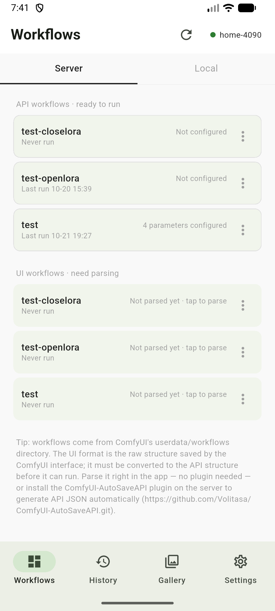
  &nbsp;
  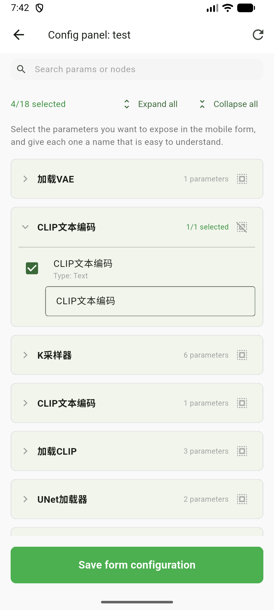
  &nbsp;
  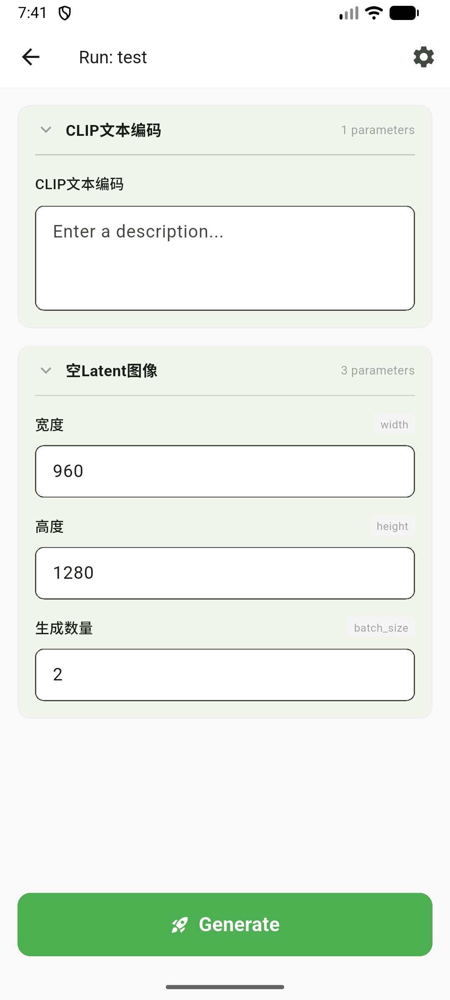
  &nbsp;
  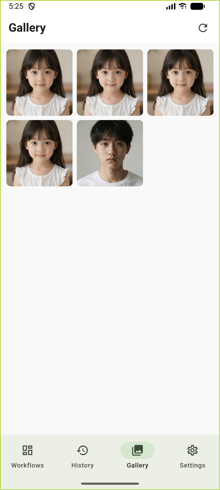
</p>

<div align="center">

<h1>ComfyUI Pocket</h1>

<p><strong>Your ComfyUI server is already running — this app lets you pick parameters, submit jobs and collect results from your phone.</strong></p>

<p>Connect to your server, browse its workflows, turn the parameters you care about into a form, submit a job with one tap, watch the progress live and get the results back in your phone's album.</p>

<p><sub>This is a third-party app and is not affiliated with or endorsed by the ComfyUI team.</sub></p>

<p>
  <a href="https://github.com/Volitasa/ComfyUI-MobilePocket/releases/latest"><b>⬇️ Download APK</b></a>
  ·
  <a href="#three-steps-to-your-first-image"><b>🚀 Quick start</b></a>
  ·
  <a href="#7-troubleshooting"><b>❓ Troubleshooting</b></a>
  ·
  <a href="#11-roadmap"><b>🗺️ Roadmap</b></a>
</p>

<p><a href="README.md">简体中文</a> ｜ <b>English</b></p>

<p>
  
  
  
  
</p>

</div>

<p align="center"><i>Captured on an Android emulator: workflow list → parameter form → job progress → local gallery</i></p>

> Every screenshot in this document was taken from the app actually running on an Android emulator: `docs/screenshots/en` for the English UI, `docs/screenshots/zh` for the Chinese UI.

**The only prerequisite**: your phone can reach the machine that runs ComfyUI (same Wi-Fi LAN, or a tunnel / public mapping). As long as the server is up.

## Connect and go: what you no longer have to do

| The usual hassle | What this app does instead |
| --- | --- |
| Converting a canvas-saved workflow into API-format JSON before you can run it on a phone | **Don't convert it.** Workflows on the server — including the UI format the ComfyUI canvas saves — are parsed into a runnable structure inside the app: tap "parse" and run |
| Sending JSON files over to your phone | **Don't send anything.** Refresh and you get every workflow in the server's `userdata/workflows/` |
| Installing plugins, opening an SSH session, memorising node IDs | **None of that.** If you saved the workflow on your PC, the phone can see it. Installing [ComfyUI-AutoSaveAPI](https://github.com/Volitasa/ComfyUI-AutoSaveAPI) only adds an extra "ready to run" copy that skips the parse — it is **not required** |

## Core capabilities

1. **Connect and run** — type the server address and the workflow list appears; UI-format workflows are parsed into a runnable structure inside the app; local JSON can be imported too.
2. **Parameters become a form** — node parameters are detected automatically; tick what you want to tweak, give it an alias, and the run page renders the right control (text / seed / int / float / slider / toggle / dropdown / image, and a size card for width/height on empty-canvas nodes). **Dropdowns are filled with the options that actually exist on the server**, so you can switch models without going back to the PC. The config page only shows what's already in your form; everything else lives in "Add parameters", grouped by purpose so even node-heavy workflows stay readable.
3. **Results land on your phone** — live WebSocket progress and five task states; outputs are downloaded into an on-device gallery (PNG metadata preserved, so you can drop them back into ComfyUI) and can be saved to your album; every history entry can be replayed with "Run again".
4. **Let an AI lend a hand with prompts (optional)** — plug in your own AI service (a DeepSeek preset is built in, and any OpenAI-compatible endpoint works) to rewrite prompts or caption an image. It only touches text, only the one target you picked, passes four checks before writing, and can be undone. Skip it entirely and nothing else changes.

**One thing in the pipeline**: running workflows through RunningHub — see [Roadmap](#11-roadmap).

## Three steps to your first image

1. **Install the APK** → open it and go to **Settings → Server connections → Add**, type the address (e.g. `http://192.168.1.100:8188`) and save. The first connection activates automatically; the badge in the top bar turns green once you're connected.
2. **Workflows tab** → tap your workflow → the config page **has already picked a set of common parameters for you**; add missing ones from "Add parameters", give them memorable names → save. For UI format, tap "parse" first (the first time loads the server's frontend — a few seconds to a dozen).
3. **Tap "Generate"** → it jumps to History and you watch it go from "Queued" to "Completed" → tap the thumbnail to view it full size and save it to your album.

Want another take? Go back to History, tap **Run again** on that card — the form and every value are already in place.

Want the AI to rewrite a prompt? Tap the **AI** button next to "Generate" on the run page (first time, set it up in **Settings → Connection → AI service** — see [5.11](#511-prompt-ai-assistant)).

---

## Contents

- [1. Full feature list](#1-full-feature-list)
- [2. Before you start](#2-before-you-start)
- [3. Install and connect for the first time](#3-install-and-connect-for-the-first-time)
- [4. UI tour](#4-ui-tour)
- [5. Feature guide](#5-feature-guide)
  - [5.1 Connection management](#51-connection-management)
  - [5.2 The three sources of a workflow](#52-the-three-sources-of-a-workflow)
  - [5.3 Parameter configuration panel](#53-parameter-configuration-panel)
  - [5.4 Run page](#54-run-page)
  - [5.5 Task tracking](#55-task-tracking)
  - [5.6 History and run-again](#56-history-and-run-again)
  - [5.7 Workflow snapshots](#57-workflow-snapshots)
  - [5.8 Gallery and saving to your album](#58-gallery-and-saving-to-your-album)
  - [5.9 Settings](#59-settings)
  - [5.10 In-app updates](#510-in-app-updates)
  - [5.11 Prompt AI assistant](#511-prompt-ai-assistant)
- [6. How the pieces fit together](#6-how-the-pieces-fit-together)
- [7. Troubleshooting](#7-troubleshooting)
- [8. Known limitations](#8-known-limitations)
- [9. Tech stack and project layout](#9-tech-stack-and-project-layout)
- [10. Development, testing and releases](#10-development-testing-and-releases)
- [11. Roadmap](#11-roadmap)

---

## 1. Full feature list

The four headline capabilities are at the top of this page; here is everything, with details in [5. Feature guide](#5-feature-guide).

| Feature | What it does |
| --- | --- |
| Multiple servers | Save any number of servers (home LAN / office), each with a **primary + backup address**; falls back automatically when the primary is unreachable |
| Three workflow sources | Server `_api.json` runs directly; server UI-format JSON is **parsed into the API structure inside the app**; local JSON files can be imported |
| Parameters become a form | Node parameters are recognised through a **data-driven rule table**; tick what to expose, give it an alias, and the run page renders the right control (text / seed / int / float / toggle / dropdown / image). The config page main view holds only selected parameters; everything else lives in "Add parameters", grouped by purpose, with search, expand-all/collapse-all and per-node select-all |
| Dropdowns with real option lists | On opening the run page, the app asks the server once; dropdowns for models (Checkpoint / UNET / CLIP / VAE / LoRA / ControlNet), samplers and schedulers are then filled with the **list that really exists on the server**, with a manual refresh in the top-right corner. If the model written in the workflow is missing there, it is flagged and submission is blocked |
| Live progress | Progress is pushed over WebSocket, showing the node currently executing plus a percentage; reconnects automatically and reconciles with the server, **including when the app returns to the foreground** |
| Five task states | Queued / Running / Completed / Failed / Interrupted, with the server's actual error message shown on failure |
| Run again | Every run keeps a snapshot (reused when the workflow content hasn't changed), so any history entry can restore the exact form and values it was run with — one tap to run it again |
| History search & filter | Search history by workflow name, prompt text or parameter alias; filter by 5 statuses; each hit explains *why* it matched |
| Drag to reorder parameters | The config page groups parameters into one card per node; **long-press any card** to drag the whole section. The order is saved, and the run page follows it |
| Pick images from the server | Besides your phone's album, an image parameter can pick **an existing image on the server** (Output / Input tabs). The value keeps its directory annotation, so nothing is uploaded again |
| Compare with reference images | The full-screen viewer in History and Gallery has a **thumbnail rail of the images that were fed in**: tap to switch, hold to compare, release to go back. Double-tap zooms, and all three viewers share the same gestures |
| Appearance & dark mode | Settings → General → Appearance: follow system / light / dark. Dark mode is a full semantic palette, not an inversion; the launch background follows it too, so the app never flashes white first |
| Haptic feedback | Optional, six categories you can switch independently (tab switch / tick a parameter / drag to reorder / expand-collapse / submit succeeded / long-press to view) |
| Prompt AI assistant | Optional, using your own OpenAI-compatible service: rewrite prompts, caption images; four checks before writing, undo available |
| Local gallery | Outputs are downloaded into the app sandbox with **original PNG metadata preserved** (droppable back into ComfyUI); grid browsing and a full-screen viewer. Videos play in the **history** viewer |
| Save to album | Choose between "original image with workflow" and "plain image with metadata stripped" |
| Chinese / English UI | Follow the system language or pin it to Chinese or English; persisted data never stores display strings, so switching languages never affects your history |
| In-app updates | Manually check GitHub Releases, download the APK and hand it to the system installer (works with private and public repos alike) |

---

## 2. Before you start

**Only one thing**: a running ComfyUI that your phone can reach. The app talks to it over HTTP and WebSocket and probes with `GET /system_stats` on startup (so the server needs to be up).

The plugin is **optional**: [ComfyUI-AutoSaveAPI](https://github.com/Volitasa/ComfyUI-AutoSaveAPI) additionally exports an `_api.json` when you **save** a workflow — the "ready to run" copy, which skips the in-app parse. **Everything works without it** — workflows you normally save on your PC already live in the server's `userdata/workflows/`, and the app lists and parses them.

The two JSON formats are good to know about; the app works out which path to take by itself:

| Format | What it looks like | How the app treats it |
| --- | --- | --- |
| **API format** (filename ends with `_api.json`) | Keyed by **node ID**, each entry has `class_type` and `inputs` | **Runs directly** (no parsing) |
| **UI format** (a normal `*.json`) | Top level is `nodes` / `links` arrays — what the ComfyUI canvas saves | **One tap on "parse"** and it runs (see [5.2](#52-the-three-sources-of-a-workflow)) |

---

## 3. Install and connect for the first time

1. Download the latest APK and install it (Android will ask you to allow installs from unknown sources).
2. Open the app, go to **Settings → Server connections → Add server**.
3. Fill in:
   - **Name**: for your own reference, e.g. "Home 4090"
   - **Primary address**: e.g. `http://192.168.1.100:8188`
   - **Backup address** (optional): e.g. a tunnel address. Tried automatically when the primary fails
4. Tap **Test connection**, then **Save**. The first connection becomes active automatically.
5. Back on the **Workflows** tab the status badge turns green once connected (it requires both a successful HTTP probe **and** an established WebSocket).

> Tip: on every launch the app first retries the last address that worked (fast path), and only falls back to the full primary/backup probing when that fails — so day-to-day opening feels instant.

---

## 4. UI tour

Four tabs at the bottom:

| Tab | What it's for |
| --- | --- |
| **Workflows** | Pick a workflow, configure parameters, open the run page. The top has a "Server / Local" switch |
| **History** | Every job you submitted: status, results, search, filters, run again, delete |
| **Gallery** | Everything downloaded to this device, in a grid |
| **Settings** | Three groups: Connection (server connections, AI service) / Data (workflow storage, snapshots) / General (language, appearance, haptics, GitHub token, about) |

A **connection status badge** (server name + status dot) sits in the top bar of the **Workflows** and **History** tabs; tapping it jumps straight to the server config page. The Gallery and Settings tabs don't carry it.

<p align="center">
  
  &nbsp;
  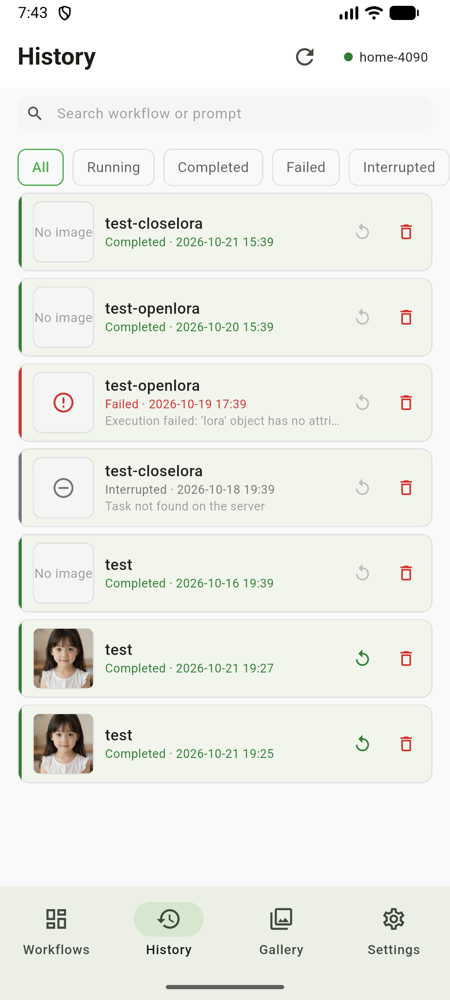
  &nbsp;
  
  &nbsp;
  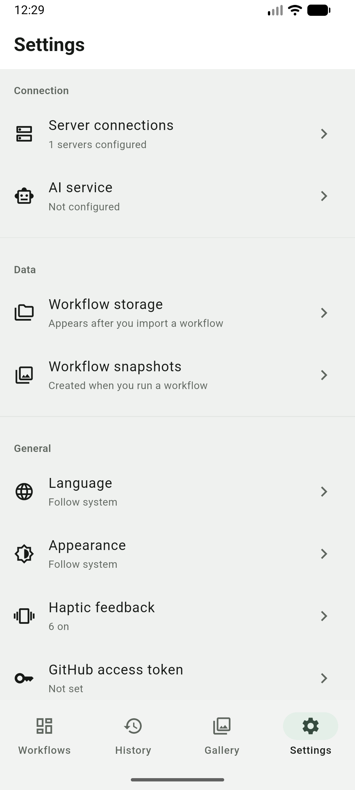
</p>

<p align="center"><i>The four tabs, left to right: Workflows / History / Gallery / Settings</i></p>

---

## 5. Feature guide

### 5.1 Connection management

Any number of server profiles, each with a primary and an optional backup address; the primary failing falls back to the backup.

**What you can do**

- Save as many server profiles as you like; exactly one is active at a time.
- Each profile has a primary and a backup address, probed in order, first one that answers wins.
- "Test connection" works on a profile without changing which one is active.
- Tap a card to make it active; the app re-probes and refreshes the workflow list.

**Key behaviours**

| Action | What happens |
| --- | --- |
| Switching servers | Clears the workflow list and the current workflow cache; **does not** touch history, gallery or local workflows |
| Deleting a server | Disconnects, and **also cleans up the parse cache belonging to that server** (those entries could never be validated again) |
| Disconnected | WebSocket retries **at most 3 times**, backing off 3s → 6s → 12s, then stops (retrying forever against a powered-off server just burns battery). Switching servers, re-testing a connection, or returning to the foreground grants a fresh set of attempts |
| A (re-)connection succeeds | Re-fetches the workflow list and reconciles non-final tasks **belonging to the current server**. A WebSocket-only reconnect does not trigger this pair |
| Editing and saving | If you edited the **currently active** profile, it re-probes primary and backup immediately (the live address may switch from primary to backup) |

<p align="center">
  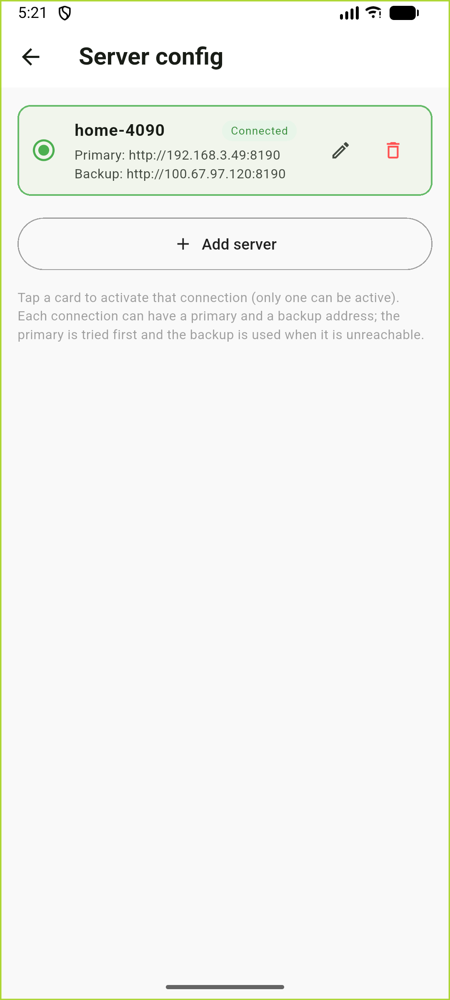
</p>

<p align="center"><i>Server config: tap a card to activate, pencil to edit, bin to delete</i></p>

### 5.2 The three sources of a workflow

This is the **first cornerstone** of the whole app. Workflows come from three places; they have different origins, so they support different operations:

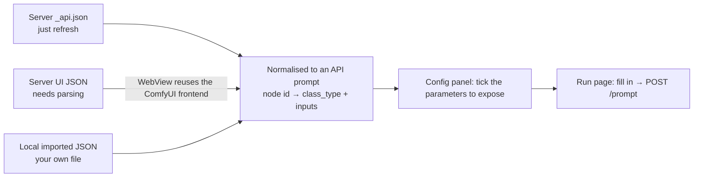

| Source | Where it lives | Regenerable? | Available actions |
| --- | --- | --- | --- |
| Server `_api.json` | Server only; the app stores just the parameter config and a content hash | Yes (refresh) | Refresh / reconfigure nodes / **save to local library** |
| Parsed server UI JSON | Parse result cached on device (key: server + filename) | Yes (parse again) | Parse / re-parse / **clear parse cache** (never "delete") |
| Local import | Stored in full on device | **No** (delete means gone) | Rename / reconfigure nodes / **delete** |

> Design principle: **deletable ⇔ re-obtainable from the source.** If the source can give it back, you don't get a "delete", you get a "re-sync". Only things that would be gone forever get full create/update/delete.

#### Server side: grouped by format

- **API workflows · ready to run**: tap to configure parameters or go straight to the run page.
- **UI workflows · need parsing**: parse manually the first time. Once parsed they are equivalent to API entries — configurable and runnable.
- **No plugin needed**: what the ComfyUI canvas normally saves *is* UI format, so one parse is all it takes. With AutoSaveAPI installed the same workflow appears twice — pick the `_api.json` copy to skip the parse step.

Each card shows a status:

| Status | Meaning | Visual |
| --- | --- | --- |
| Not configured / not parsed yet | No parameter config saved | Grey subtitle |
| N parameters configured | Ready; tapping goes to the run page | Normal |
| Content updated, please reconfirm | The workflow content on the server changed, old parameters may no longer fit | Card turns amber |
| Server has an update (UI workflow) | The UI JSON changed, you can re-parse | Card turns amber |

The second line of each card shows the **last run time** (from the local history; "Never run" if it hasn't). When you're hunting for a workflow, "which one did I run last" is often easier to recognise than the name. The list uses compact single-line cards — a screen fits about a dozen.

> **How does it know the server changed?** Every configured workflow stores a content hash. Refreshing re-fetches the content and compares, so server-side edits are detected instead of you silently running against stale parameters.

#### Local side: your own assets

- Tap **Import workflow JSON** to pick an API-format JSON from your phone (importing the same file twice reuses the same config instead of duplicating).
- The menu offers **rename**, **reconfigure nodes** and **delete** (deleting also drops its parameter config).
- Local workflows are **independent of any server** — they may or may not run on the currently connected server (models/plugins may differ), and the app makes no promise about that.

#### "Save to local library"

**API-format server workflows** (`_api.json`) can be saved to the device with "Save to local library", becoming your private asset — for example when the server copy gets broken or deleted, you still have one. The parsed result of a UI workflow already lives on the device, so its menu only offers re-parse and clear-cache; there is nothing extra to save.

<p align="center">
  
  &nbsp;
  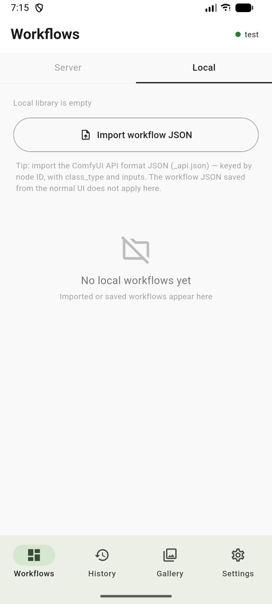
</p>

<p align="center"><i>Left: server side (grouped by API / UI format)　Right: local side (your assets + import entry)</i></p>

### 5.3 Parameter configuration panel

Pull node parameters out of the workflow and turn them into a phone form. Open it by tapping a **not-yet-configured** workflow, or choosing "reconfigure nodes" from any card menu.

**Two layers, each doing one job**

- **The main view only shows what's already in your form**: a header line "17 of 18 in your form", then **one card per node** — inside a card, one row per parameter (alias + which node it belongs to and its current value), with an × to remove it. **Long-press a card to drag the whole section**; the order is saved and the run page follows it. Renaming, removing and reordering only change the phone form, never the workflow itself.
- **"Add parameters" holds everything**: every parameter lives in this layer, **grouped by purpose** (Prompt / Sampling / Size / Model and weights / Fine control / Other nodes), with per-node collapsible cards. Search, bulk expand/collapse and per-node select-all all live here.

**What it does**

1. Walks every node in the workflow and asks the **built-in rule table** which parameters are worth exposing.
2. Decides the type: the **server's node specs** (`/object_info`) come first — dropdown, toggle or number is decided by them; when specs are unavailable it falls back to name/value inference and says so with a banner at the top.
3. Skips **link references** (values shaped like `["nodeId", 0]`) — those aren't yours to fill in.
4. Selected parameters go to the main view, the rest stay in "Add parameters" — **coverage is never narrowed away**: for nodes the rule table doesn't know, every fillable parameter is still listed (that's what covers community nodes and `LoadImage`'s upload box).

**Same-name nodes, told apart by wiring**: when a workflow has two `CLIPTextEncode` nodes (positive and negative prompts), each card in "Add parameters" carries a second line saying **which node's which input it feeds** (e.g. `Feeds KSampler · positive`). Model / LoRA loaders follow the same rule — which file they load is already shown as the current value in their parameter row. The node name is ComfyUI's own node title and the input name is the workflow's own parameter key — **both are shown as-is, never translated**; when an output feeds several places it shows the first one plus "N targets in total", and a node with no downstream simply omits the line instead of guessing.

**What's covered**: the rule table is grouped by *purpose*, not by class name (the same feature has different class names on different machines):

| Group | Covered nodes |
| --- | --- |
| Samplers | `KSampler`, `KSamplerAdvanced`, `SamplerCustom(Advanced)`, `BasicScheduler`, `KSamplerSelect` |
| Text / prompts | `CLIPTextEncode`, `Text Multiline`, `Text box`, `String Input`, `Text Input`, `PrimitiveStringMultiline`, `Text Concatenate` |
| Size / upscale | `EmptyLatentImage`, `EmptySD3LatentImage`, `EmptyFluxLatentImage`, `LatentUpscale(By)`, `ImageScaleBy`, `ImageUpscaleWithModel`, `UpscaleModelLoader` |
| Model loaders | `CheckpointLoaderSimple`, `UNETLoader`/`UnetLoaderGGUF*`, `CLIPLoader`/`CLIPLoaderGGUF`, `VAELoader`, `CLIPVisionLoader` |
| LoRA / patches | `LoraLoader`, `LoraLoaderModelOnly`, `ModelPatchLoader` |
| ControlNet | `ControlNetLoader`, `ControlNetApplyAdvanced`, `SetUnionControlNetType` |
| IPAdapter | `IPAdapter`, `IPAdapterFaceID`, `IPAdapterNoise`, `IPAdapterUnifiedLoaderFaceID`, `IPAdapterInsightFaceLoader` |
| Face swap | `ReActorFaceSwap` |
| Matting / mask compositing | `RMBG`, `FeatherMask`, `ImageCompositeMasked` |
| ControlNet preprocessors | `DWPreprocessor`, `DepthAnythingV2Preprocessor`, `DensePosePreprocessor`, `CannyEdgePreprocessor`, `TilePreprocessor`, `HEDPreprocessor` |

- **A rule's candidate list only decides what gets ticked by default — it never trims the list**: ControlNet preprocessors tick only `resolution`, `RMBG` ticks model / sensitivity / process resolution, but that node's other parameters still appear on the "Add parameters" page, just unticked. Better to list a few extra rows than to make a parameter invisible.
- **Uncovered nodes are not dropped**: the fallback rule lists **every fillable parameter** on the node (link references are skipped automatically) — that's what covers arbitrary community nodes without touching a line of code. But **only the high-frequency ones are ticked by default**; the rest wait for you to add them, so the form never fills up on its own.
- **The trade-off is that the fallback ignores node complexity**: nodes with a huge parameter count — measured at 68 for `ModelMergeQwenImage` and 65 for `ModelMergeFlux1` (block merge: one parameter per block) — have no narrowing rule, so all their parameters show up at once on the "Add parameters" page. They default to only the high-frequency parameters, though, so the main view doesn't suddenly fill up with dozens of rows.
- **Forced types**: parameters like `denoise`, `strength_*`, `mask_blur` are often integers in the JSON (`"denoise": 1`) but semantically fractional; they're forced to float, otherwise the phone keyboard can't type `0.5`.
- **Three cases for default ticking**: ① the rule names its defaults (e.g. `strength` on `ControlNetApplyAdvanced`) → only those are ticked; ② the rule names neither defaults nor candidates → **all** of that node's parameters are ticked (anything in the rule table is worth tweaking on a phone), and you untick what you don't want — a rule that lists candidates only ticks those; ③ **uncovered nodes → only the high-frequency ones are ticked** (seed, prompt text, image, steps, CFG, sampler, scheduler, width/height, batch size, model names), and you add the rest yourself.

**Bulk actions on the "Add parameters" page** (handy when there's a lot to configure)

| Control | What it does |
| --- | --- |
| Search box (top of the page) | Filters by parameter name, alias or **node class type**; **only the matching parameters are shown**, and matching groups auto-expand |
| Counter (e.g. `17/18 selected`) and Expand all / Collapse all | The counter shows how many parameters are exposed; expand/collapse **without touching selections** |
| Select all / Clear selection icon in a card header | Applies to **that card only**, separate from the expand hotspot |

**Default aliases**: the built-in alias table comes first ("Steps", "CFG scale", "Seed"); the node title you gave it in ComfyUI (e.g. "Base settings") is used **only when the node has a single parameter**; otherwise the server's real parameter key is shown (`type`, `device`). A multi-parameter node would otherwise end up with three parameters all called "Load CLIP". Aliases are **content you saved**, so they are never translated when you switch the UI language.

**The "Re-parse" button**: after the server workflow changes, re-parsing re-extracts parameters from the new structure: **new parameters are added, parameters that no longer exist disappear, and the names you gave plus your selections are kept** (even alias edits you haven't saved yet). Types and current values always come from the new parse.

<p align="center">
  
  &nbsp;
  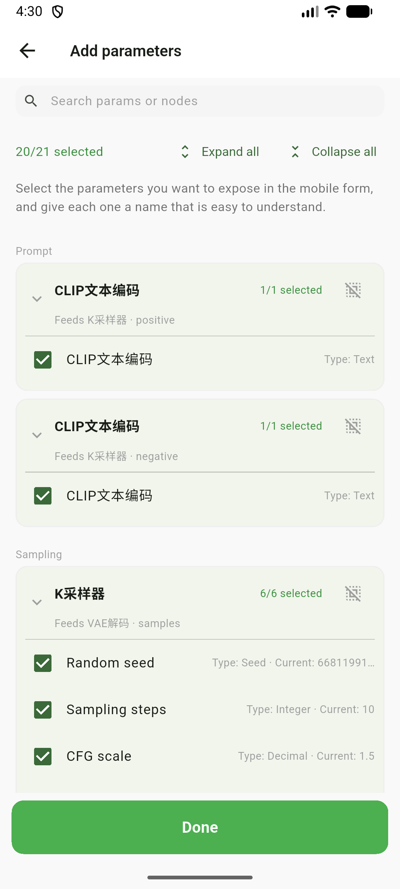
</p>

<p align="center"><i>Left: the main view holds only what's in your form, × removes a row　Right: "Add parameters" groups everything by purpose; same-name nodes say what they feed</i></p>

> Saving the config takes you to the run page; the gear icon in the run page's top-right brings you back to the config panel. The two replace each other rather than stacking up routes.

### 5.4 Run page

Fill in the parameters and submit. Controls are rendered according to the configured type:

| Type | Control | Notes |
| --- | --- | --- |
| Text | Multi-line field | Prompts etc. |
| Seed | Number field + **random button** | Keeps the workflow's own value, never randomising behind your back; a random seed is generated only when there is no value at all |
| Int / Float | Number field | Steps, CFG, denoise, … |
| Slider | Slider + editable number field | Only numeric parameters with **no more than 100 stops** become sliders — in practice `denoise`, `start_percent` and other 0–1 ranges. Steps (9999 stops), CFG (1000) and width/height (64-step) are far past that limit and stay plain fields: dragging 1px across a ~70dp track to skip hundreds of steps is unusable |
| Enum | Dropdown | Sampler, scheduler, model names, … (see "real options" below) |
| Toggle | Switch | Boolean parameters |
| Image | Image on the left, actions on the right | The thumbnail **opens a full-screen viewer** (zoomable); the right column holds the file name, a source label and two buttons: "Choose image / Change image" from your phone, and "From server" to pick an image that already lives there. The source is spelled out: Local · to upload / Server · Input / Server · Output |

> **Size card**: width/height and batch size on empty-canvas nodes like `EmptyLatentImage` are not plain number fields but a **size card** — aspect ratio (1:1, 16:9, …), long-edge presets (768 / 1024 / 1280 / 1536) and a batch stepper, with width/height snapped to multiples of 64, or type them yourself.

Parameters stay grouped by node and are expanded by default: tap a card header to fold that node, or use the **expand/collapse menu** in the top-right to fold or unfold everything at once. Adjacent paired parameters in the same node (width/height, steps/CFG, the two LoRA strengths, …) sit **two per row** when the screen is wide enough and fall back to a single column when it isn't.

At the bottom, "Generate" is the primary button; the narrow **AI** button beside it opens the prompt assistant — **long-pressing any parameter name** opens it too, with that parameter pre-filled as the write target (see [5.11](#511-prompt-ai-assistant)).

**Dropdowns are filled with what the server really has**: opening the run page asks `/object_info` once per **node that owns the parameter**, so every dropdown-type parameter gets the server's real option list — models (Checkpoint / UNET / CLIP / VAE / LoRA / ControlNet), samplers and schedulers are the classic cases, and third-party enums (`type`, `device`, `bit_depth`, …) are fetched too. Install a new model on the PC and tap refresh in the top-right corner to pick it up.

Two boundaries: **image upload parameters deliberately do not fetch** (they would become a list of server filenames and you could no longer upload a new image), and **the pre-submit block only applies to model/sampler keys** — if such a value is missing on the server it is flagged and submission is blocked, whereas other dropdowns are not blocked even when their value isn't among the server's options. With no connection or a failed request, dropdowns fall back to "just the current value", exactly as before.

**What "Generate" does**

1. Validates that the current workflow data is ready and belongs to the right entry (so you can't submit the wrong workflow).
2. **Server-side check**: if the server doesn't know this node, or a model/sampler value isn't found there, it stops here and explains why instead of firing a doomed request.
3. Handles image parameters by source: a freshly picked phone image is uploaded with `POST /upload/image`; an image picked from the server is **submitted as-is** (the value carries its directory annotation, e.g. `[output]`, so nothing is uploaded); an untouched parameter keeps the workflow's original image and never overwrites the other image parameters you did change.
4. Deep-copies the workflow JSON and writes the form values back into the corresponding nodes' `inputs`.
5. Submits with `POST /prompt`.
6. On success: **freezes a workflow snapshot**, writes a history entry, and switches to the **History** tab.

**Failures tell you why**, instead of a generic "submit failed": network timeouts, HTTP status codes, and the server's `node_errors` (which lists the offending node IDs).

**A mistyped number won't silently become empty**: each value goes through `num.tryParse`; if it fails to parse, the app falls back to the workflow's original value rather than submitting `null` (seed is the exception: with no usable value it falls back to `0`). Parameters that carry a min/max/step in the server spec also show a red hint when you go out of range — **a hint only, never a block**, because some workflows step outside the range on purpose.

<p align="center">
  
</p>

<p align="center"><i>Run page: controls rendered by type, with "Generate" pinned at the bottom</i></p>

### 5.5 Task tracking

Tasks have five states, with progress pushed live over WebSocket:

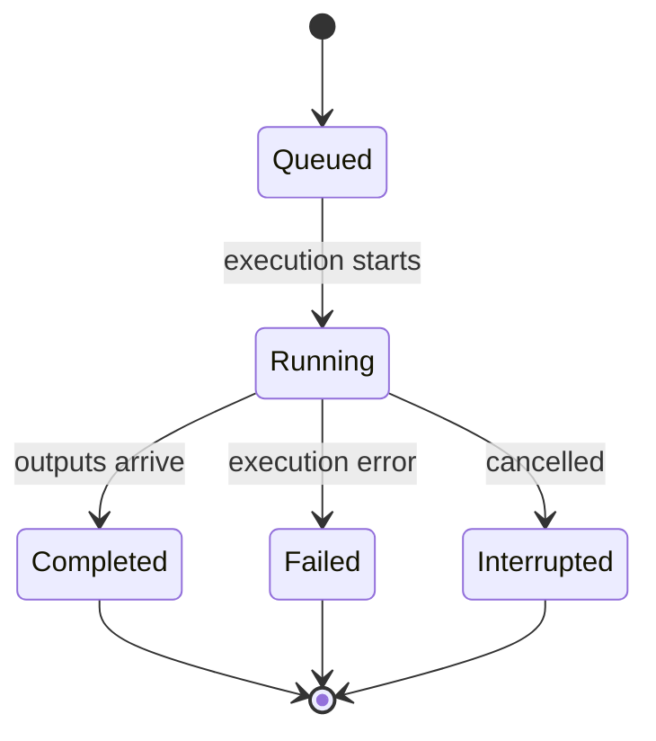

| State | Triggered by | Display |
| --- | --- | --- |
| Queued | Just submitted, not picked up yet | Amber + "Waiting…" |
| Running | An execution event arrived | Amber + current node name + percentage bar |
| Completed | Output received | Green + thumbnail |
| Failed | Server returned an error | Red + **the actual error reason** |
| Interrupted | Cancelled, or the server doesn't know the task | Grey |

The card's third line spells out a more precise **phase**: waiting / task started / **cache hit** (the server reused a previous result instead of really running it) / running (node name + percentage) / succeeded / error (the server's own message) / interrupted / not found on the server / result failed to parse. A phase that just repeats the state isn't shown twice.

**Manual stop**: a queued / running task shows a **stop button** on its history card; tapping it asks for confirmation first (progress already computed is lost). It prefers ComfyUI's per-task cancel endpoint (`/api/jobs/{id}/cancel`) and falls back automatically on older servers. If the stop can't go through (offline, or the server refuses), the snackbar offers an "Delete anyway" escape hatch so the entry doesn't stay stuck on "Running" forever.

**Where progress comes from**: a WebSocket (`ws://<server>/ws?clientId=…`) pushes events in real time, including which node is running and the percentage. Node names prefer the title you saved in the config panel over a bare node ID.

**It survives crashes and disconnects**: the app queries `/history` and `/queue` and corrects tasks still marked queued/running into their real final state; tasks found in neither are treated as "interrupted (the server may have restarted)" instead of spinning forever. Four things trigger it: **a (re-)connection succeeding**, **returning to the foreground with a pending entry**, **tapping refresh on the History page**, and **stopping a task**. Reconciliation only touches tasks belonging to the current server (very old entries with no server recorded are treated as current), so a job running on another server is never mistaken for interrupted.

**Returning from the background doesn't leave stale progress**: Android may silently kill a backgrounded WebSocket (a half-open connection that never fires the disconnect callback, so auto-reconnect never starts). When the app comes back to the foreground it rebuilds the connection and reconciles once — and only if there actually is a pending task, so an idle app never bothers the server.

### 5.6 History and run-again

Each entry is a compact card: a status colour bar and thumbnail on the left (multiple images show a count badge), then the title and status + time; meaningful phase notes (e.g. an interruption caused by a server restart) get their own line. **Run again** is always on the right; for a pending entry that slot holds the **stop** button instead (there is no delete while it runs), and for the rest it's **delete**. Delete asks for confirmation, and only offers the two-way choice — **record only** (keep the gallery images) or **also delete the gallery images** (not recoverable) — when the entry actually has local images. Deleting collapses the card in place and then removes it — and there is **no undo** (deleted means deleted). A record whose snapshot is gone stays tappable and explains why instead of failing silently.

**Search and status filter**

- The search box spans the list above the cards and filters **live** (the history cap is 50 entries, so no debouncing needed).
- It matches the workflow's **display name** + the **parameter values submitted in that run** + parameter **aliases** (aliases require the snapshot to still exist; if it was deleted, matching degrades to values only).
- Multiple keywords are split on spaces; **all of them must hit the same field** — this avoids a record matching merely because "cat" is in the positive prompt and "windowsill" in the negative one.
- **Numbers are not matched**: searching `7` won't hit a record just because `cfg=7`, which would only add noise.
- Case-insensitive; an empty keyword returns everything unchanged.
- On a hit, the card shows a **match summary** explaining why (e.g. `CLIP text encode: …human…`). Matches by workflow name don't repeat the name.
- The status filter has 5 options: All / Running (queued + running merged) / Completed / Failed / Interrupted, and combines with the search.
- Two distinct empty states: "no matching records" vs "no records yet", so you never think your history was lost.

<p align="center">
  
  &nbsp;
  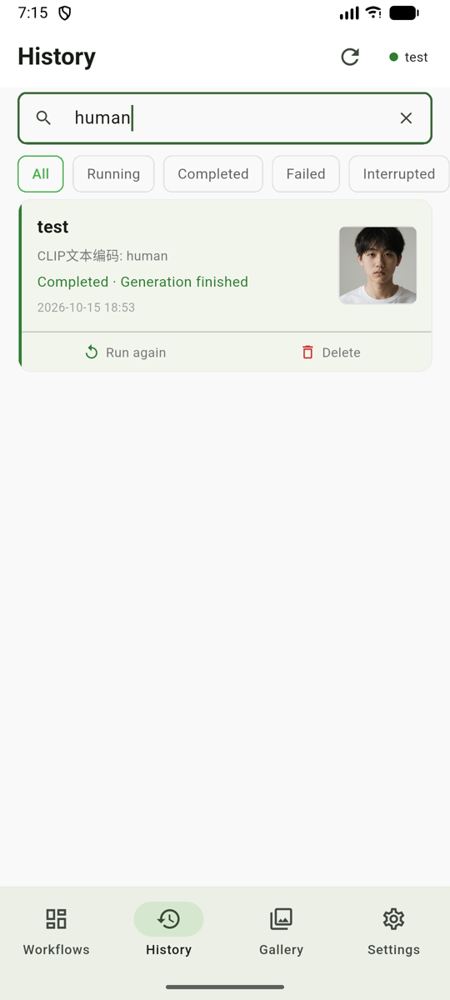
</p>

<p align="center"><i>Left: default view with the status filter row　Right: searching "test" matches all 6 entries by workflow name</i></p>

**Run again** — one of the most useful things this app does:

- Every run keeps a **snapshot** (the workflow JSON plus the parameter config at the time); content that hasn't changed reuses the same snapshot and only syncs the latest config, so any history entry can still reconstruct the form it was run with.
- Tapping "Run again" rebuilds the form from the snapshot and **pre-fills the values you typed then** (prompt, seed, … — never randomised behind your back). Image parameters are included: the images that run actually used come back (a locally picked image is remembered as the copy you uploaded); change only one of two and the other **isn't quietly reverted** to the workflow's original.
- If you later changed the exposed config so some old parameters no longer exist in the current form, it says exactly "N parameters could not be applied due to config changes" instead of dropping them silently.
- If the currently connected server **isn't** the one the job ran on, it warns first (models/plugins may differ and you may get "model not found"), and lets you decide. Entries from older versions recorded no server, so they go through this confirmation too (shown as "unknown server" on both sides).

**Viewing the result**: tapping the thumbnail opens the full-screen viewer — double-tap to zoom (up to 6×, without accidentally paging while zoomed), with the position at the top (`1 / 5`). Along the bottom is a thumbnail rail of the **images that run actually fed in**: tap one to switch to it, hold to compare temporarily (the hint reads "Input 1 / 2 · release to return to the output"), release to go back; below that is "Save to device". If a reference image has been cleaned off the server, or its server was removed, the app says so instead of failing silently.

> Deleting a record does **not** delete its snapshot — a snapshot may be referenced by other records. Snapshot cleanup is manual, on the settings page.

### 5.7 Workflow snapshots

The foundation of "run again".

| Question | Answer |
| --- | --- |
| What is a snapshot | The "original workflow JSON + the node exposure config at that time" frozen by a run |
| Why bother | Decoupling from the server — even if that file is deleted or edited on the server, history entries can still re-run from the snapshot |
| When is it created | On every successful submission (reused as-is when the content is unchanged, with only the latest config synced) |
| Does changing the config create more | No. Snapshots are de-duplicated by **workflow content**, so editing the exposure config never invalidates existing records |
| How to clean up | Settings → Workflow snapshots; each entry shows how many records reference it, and can be deleted manually |

<p align="center">
  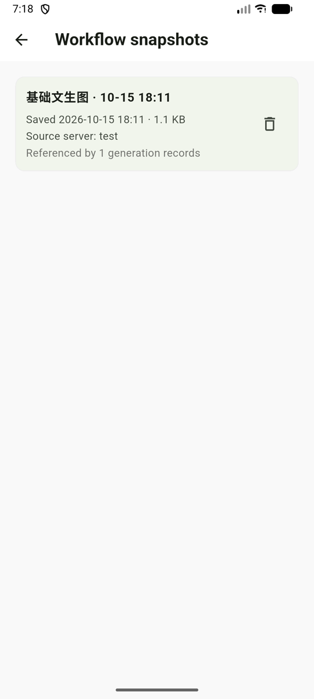
</p>

<p align="center"><i>Snapshot list: freeze time, size, source server and reference count</i></p>

### 5.8 Gallery and saving to your album

**Gallery**: a dedicated tab, a three-column grid of everything downloaded to this device (pull to refresh, or the refresh button in the top bar; an empty state explains itself when there's nothing yet). Tapping opens a full-screen viewer (the position is shown at the top, e.g. `1 / 5`) with pinch zoom, **double-tap zoom**, swipe between items and per-image delete behind a confirmation. There's also a share entry — **not live yet**, it currently says "coming soon".

If this image can be traced back to the record that produced it **and** that record's snapshot still exists, the viewer also offers **"Run again"**: it re-runs the workflow as it was. It is not "reproduce this exact image" — generation is random — and the app says so before you tap.

The same reference rail sits at the bottom (the images fed into that generation): **tap** one to open it in a single-image viewer that stays until you tap the picture again; **hold** to peek, release to return to the output.

> The gallery grid renders images only. Videos (mp4 / webm / mov) play in the **history** viewer.

**Saving logic**:

- Images are read from the already-downloaded local file first (no re-download); the album permission is requested once the bytes are in hand — a denial shows a message rather than failing silently.
- For PNGs it asks first: **original image with workflow** (keeps the ComfyUI metadata, so you can drop it back into ComfyUI to reproduce) or **plain image (info stripped)**.
- Videos (mp4/webm/mov) are written to a temp file and then saved to the album.

**Automatic download**: after a successful generation the app downloads the output media into the local gallery directory with **the original PNG metadata preserved**, so you can view and save it even offline.

<p align="center">
  
  &nbsp;
  
  &nbsp;
  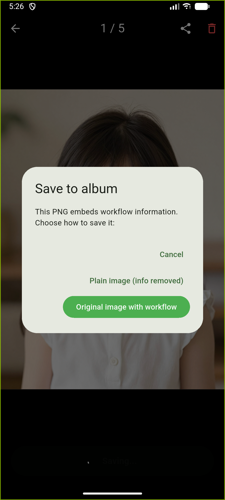
</p>

<p align="center"><i>Gallery grid → full-screen viewer → the two choices when saving to the album</i></p>

### 5.9 Settings

| Group | Entry | Purpose |
| --- | --- | --- |
| Connection | **Server connections** | Add, edit and delete servers, test connections, switch the active one |
| Connection | **AI service** | The provider used by the prompt assistant: a built-in DeepSeek preset, or any OpenAI-compatible endpoint; several can be saved, one is active, each can be tested (see [5.11](#511-prompt-ai-assistant)) |
| Data | **Workflow storage** | Everything saved on this device, grouped into "local assets / parse cache", with disk usage; local assets can be deleted, parse cache can only be cleared |
| Data | **Workflow snapshots** | All snapshots, reference counts, source server, manual deletion |
| General | **Language** | Follow system / Chinese (Simplified) / English; the choice is stored locally |
| General | **Appearance** | Follow system / light / dark, stored locally; dark mode is a full semantic palette, not an inversion |
| General | **Haptic feedback** | Six categories, switched independently: tab switch / tick a parameter / drag to reorder / expand-collapse / submit succeeded / long-press to view — plus all on / all off |
| General | **GitHub access token** | Optional. Needed for a private repo; a public one works without it, only the anonymous API quota is lower |
| General | **About** | Version, check for updates |

**About the UI language**

- Defaults to following the system; a system language that is neither Chinese nor English falls back to **Chinese**, and you can also pin it manually in Settings.
- Persisted data **never stores any display text**: task states are stored as enum names (`queued`/`running`/`completed`/`failed`/`interrupted`), while dynamic content (node names, raw server errors) is stored separately; leftovers from older versions in Chinese are migrated on read.
- As a result, switching languages never affects your history: titles are re-rendered in the current language while parameter values, images and snapshots stay exactly as they were.
- The only things not translated are **content you named or configured yourself**: workflow titles, parameter aliases, model names and node names (which are English in ComfyUI anyway).

**About appearance**

- Follows the system by default, or can be pinned to light / dark; the choice is stored locally too.
- Dark mode isn't an inversion of light: the whole semantic palette (cards, borders, state colours, input fields) is defined separately, and the launch background follows it so the app never flashes white before turning dark.
- The one exception is the image viewer, which stays pure black regardless of theme.

**About haptic feedback**

- Six categories, each switchable on its own, plus all-on / all-off; everything is on for a fresh install.
- It governs haptics the app itself triggers (tab switch, ticking, dragging, folding, submitting, long-press viewing). Haptics the system adds, like text-selection feedback inside a field, are outside its control.

<p align="center">
  
  &nbsp;
  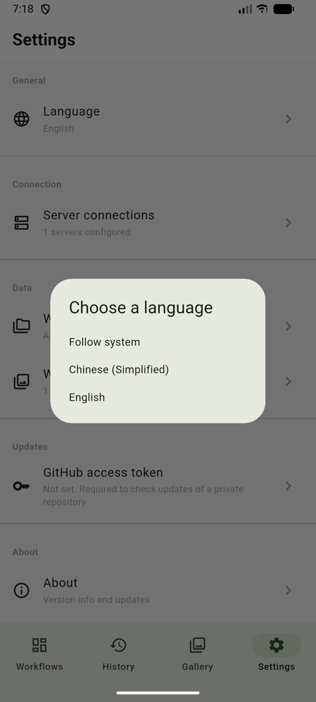
  &nbsp;
  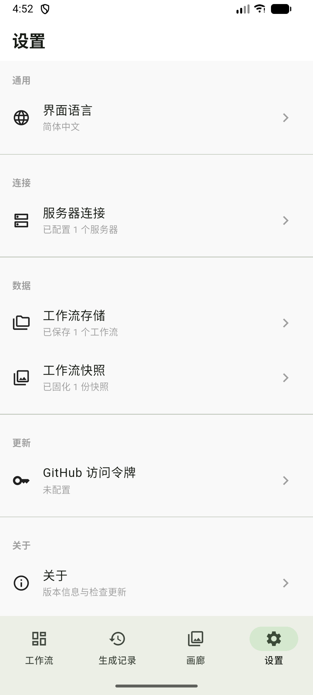
</p>

<p align="center"><i>Settings → language picker → the same page after switching to Chinese</i></p>

### 5.10 In-app updates

- **Manual only** (no background checks): tap "Check for updates" on the About page, which queries GitHub Releases and compares with the current version.
- When an update exists it shows the version, package size and release notes (Markdown markers are stripped), then "Download and install" runs a progress bar and hands the APK to the system installer.
- **Private and public repositories both work, with no code change**:
  - With no token the app queries anonymously. If the repo is **public**, updates are found and downloaded straight away.
  - If the repo is **private**, anonymous requests get a plain 404 from GitHub (not a 403), so you need a read-only token with Contents access. The token is **stored on device only** and never uploaded.
  - When a token expires or is revoked, the app **falls back to an anonymous retry** automatically — so if the repo switches from private to public, existing users keep getting updates without having to clear the token first (both the lookup and the download fall back).
- **In-app installation is Android-only**: on other platforms it tells you a new version exists and points you to the Release page for a manual download.

### 5.11 Prompt AI assistant

**This section is optional and needs your own AI service.** The app ships no model and pays no fees: set one up under **Settings → Connection → AI service** (a DeepSeek preset is built in, or enter your own endpoint, model and key). Everything else works without it.

**Two ways in**

- The **AI** button next to "Generate" on the run page;
- **Long-press any parameter name** — it opens the sheet with that parameter pre-filled as the write target (text parameters) or as a reference input.

**A typical round trip**

1. **Inputs** (multi-select): tick the nodes worth referencing — prompt text, or images (up to 4).
2. **Output** (single select): choose one **text parameter** as the write target.
3. Type an instruction, or pick a template (Custom / Caption an image / Rewrite) — a template just pre-fills one sentence, it is not a different model.
4. Tap "Generate"; you can stop it at any time. Image captioning reads the originals first (the footer shows "Reading image x/y").
5. The result is a **suggestion card**: it shows how the character count changes, and you can copy it or write it back.
6. After writing, the form holds the new text and you can **undo** back to what was there before.

**Writing is gated** (which is what makes it safe to touch the form directly):

- Only **text parameters** — images, numbers, dropdowns and toggles are never touched;
- Only the **one target you picked**: if the model proposes changes to other nodes, they are rejected;
- If the workflow or the parameters changed in the meantime (node gone, key no longer matching) → refused, with a reason;
- Longer than 8000 characters → refused;
- There is a context budget (~6000 characters): when it overflows, model info goes first, then the oldest text — never the passage you're editing.

**Privacy and cost**

- The key is stored in plain text in the app's private storage and **only ever sent to the address you configured** — never through a middleman.
- AI sessions are not persisted: close the sheet and they're gone; only the text you explicitly write lands in the form.
- Any usage fees are billed to your own AI account.

**When images or the service are unreachable**: image captioning needs to read the original from the server (deleted images can't be fetched); service failures are reported by cause (invalid key / wrong address or model / rate limited / timed out …) rather than a generic "failed".

<!-- Screenshot placeholder: AI sheet (inputs / output / instruction) and the AI service settings page.
     Suggested names: docs/screenshots/{zh,en}/15-ai-sheet.png, 16-ai-service.png -->

---

## 6. How the pieces fit together

### How the data flows

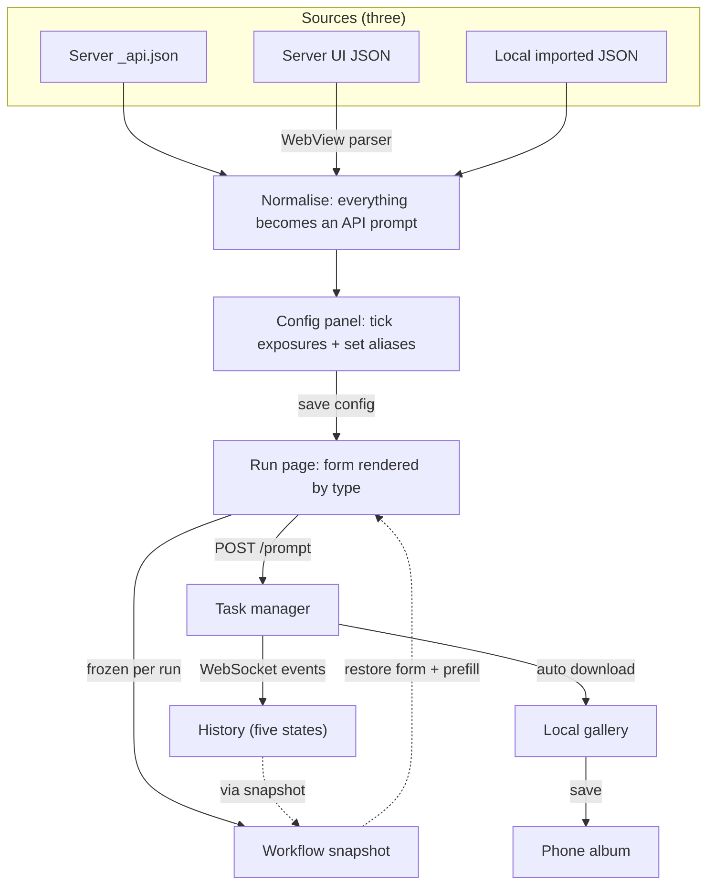

### Three sources → one pipeline

All three paths normalise into **the same structure** (node ID → `{class_type, inputs}`), so the config panel and the run page need only **one** implementation instead of one per source. That's also why UI format must be parsed rather than run directly.

### Snapshots decouple "running" from "history"

```
one run ──▶ history entry (snapshot id + submitted params + status / progress / outputs / server)
        └──▶ snapshot  (workflow JSON + node config; one copy per distinct workflow content)

delete a record ──▶ the snapshot survives (other records may reference it)
run again       ──▶ restore the form from the snapshot + prefill from the record's params
```

So even if that workflow has since changed or been deleted on the server, "run again" still works — **your history never rots because the server moved on**.

### Three kinds of ownership, three lifecycles

| | Server workflows | Parse cache | Local assets | Snapshots | History | Gallery images |
| --- | --- | --- | --- | --- | --- | --- |
| Lives on | Server | Device | Device | Device | Device | Device files |
| Invalidated by server changes | Yes | Yes (prompts a re-parse) | No | **No** | No | No |
| Deletable | Not offered | "Clear" only | Yes | Yes | Yes | Yes |
| Limit | None | None | None | None (usage shown in settings) | Latest 50 | None |

### Behaviour at the edges, with multiple servers

- Switching servers clears the workflow list (local entries, gallery and local workflows are unaffected).
- Each task records **which server it belongs to**; reconciliation only touches tasks of the current server, so it never mislabels a job still running elsewhere as "interrupted".
- Running again against a different server warns you first and lets you decide.

---

## 7. Troubleshooting

| Symptom | Cause and fix |
| --- | --- |
| The badge stays red | Either the HTTP probe or the WebSocket failed. Check the server is running, the address/port is right, and the phone is on the same network. Tap the badge, then "Test connection" on the primary/backup addresses |
| "No workflows found" on the server side | No JSON files in `userdata/workflows/`. **Save a workflow once** in ComfyUI on your PC — **no plugin required**; AutoSaveAPI only adds an extra `_api.json` copy |
| Parsing a UI workflow fails / times out | Parsing loads the whole ComfyUI frontend; on a slow device it can take a dozen seconds. Confirm the phone can open that server's web UI normally, then retry with "Re-parse" |
| Parsing succeeds but reports "no dynamically editable parameters" | Every parameter is a **link reference** (or its value type can't be mapped to a control). Hit "Re-parse" in the config panel and try again; if it still fails, this workflow genuinely has nothing worth filling in on a phone |
| A card turned amber saying "content updated" | The workflow content on the server changed, so old parameters may not fit the new structure. Open it and reconfirm the config |
| Submitting returns HTTP 400 listing nodes | Server-side validation failed (commonly a missing model name or node type). Check the listed node IDs on your PC |
| A task is stuck at "Running" | A final event was missed while offline or backgrounded. Tap refresh in the History top bar to reconcile (a successful (re-)connection and returning to the foreground with a pending entry also reconcile) |
| Search can't find an old record | Three possibilities: ① older records stored no "submitted parameter values", so only the workflow name is searchable; ② parameter **aliases** need the snapshot to still exist — if it was deleted in settings, matching degrades to values only; ③ **numbers are not matched**, so searching `7` won't hit `cfg=7` |
| The "Add parameters" list goes empty after typing in search | Search is a **per-parameter filter**: only matching parameters are shown, and no match means "no matching parameter". The keyword must appear in a parameter name, alias or node name |
| Aliases are still Chinese after switching to English | Aliases are content saved at configuration time — your own data, not translated with the UI language. Just rename them in the config panel |
| "Repository not accessible" when checking updates | Either the repo really is private, or the token has no Contents access to it. On a rejected token the app retries **anonymously**; if that is refused too, the problem is the repo's permissions — clearing the local token won't help |
| Saving an image to the album fails | Album permission is required the first time |
| The AI button does nothing / asks you to configure something | No AI provider yet: Settings → Connection → AI service (the DeepSeek preset only needs a key) |
| The AI says it "can't write" | One of four reasons: the target isn't a text parameter, it isn't among the targets you picked, the workflow changed underneath, or the text exceeds 8000 characters. The suggestion card names the actual one |
| Picking from the server only lists "already generated" images | That server's internal directory endpoint isn't available, so it fell back to reading the generation history; the picker says so at the top |
| The seed parameter lost its dice button | An old saved config stored its control type as a plain number. Tap "Re-parse" once in the config panel (it now keeps your names and selections) and the button comes back |

---

## 8. Known limitations

These are real boundaries of the current version, not bugs:

- **Image parameters never become dropdowns**: every other dropdown (including third-party enums) fetches the server's real list by the node that owns it. Image parameters get a dedicated card instead (phone album or server directory) — as a dropdown they would just be a list of filenames you can't upload past. Separately, **the pre-submit block only applies to model/sampler keys**: other dropdowns aren't blocked even when their value isn't among the server's options.
- **Real dropdown options depend on the current connection**: with no connection, or when the request fails, dropdowns fall back to "just the current value" — exactly the old behaviour, with no error. The list is fetched when the page opens, so a model you just installed on the PC needs a tap on the refresh button.
- **Numeric parameters aren't hard-blocked by range**: min/max/step are read from the server spec (rendered as a slider when there are no more than 100 stops); going out of range only shows a red hint, it never blocks submission — some workflows step outside the range on purpose. Without a spec it falls back to a free-text field, and a non-numeric entry falls back to the workflow's original value (it never submits an empty value).
- **Nodes with a huge parameter count have no narrowing rule**: block-merge nodes like `ModelMergeQwenImage` and `ModelMergeFlux1` measure at 60–68 parameters on a single node; they only get the fallback, so every fillable parameter is listed at once on the "Add parameters" page (only high-frequency parameters are ticked by default, so the main view is unaffected).
- **Image parameters record which image on the server**: the value carries a directory annotation (e.g. `xxx.png [output]`), so input and output directories both work; but if that image is deleted server-side (input cleanup, output cleanup, a different machine), references in old records stop resolving — the record itself and the images already downloaded to your phone are unaffected.
- **Picking images from the server relies on an official "internal" endpoint**: it is preferred for listing directories, and the official docs say it isn't guaranteed across versions; when it isn't available the picker falls back to reading the generation history, so you can only choose images that have been generated — the page says so.
- **The AI assistant needs your own AI service**: without one the feature is unavailable. The key is stored in plain text on the device; different services differ in image support, context length and rate limits, and errors are reported by cause.
- **The AI only writes text parameters**: images, numbers, dropdowns and toggles are never touched, and only one target per write. You still have to judge the output — it can read smoothly and still ruin the tone.
- **AI sessions aren't saved**: close the sheet and the conversation is gone; only the text you write lands in the form, so copy anything you want to keep.
- **Search covers the latest 50 records only**: that's the history cap itself, and search is a plain local filter with no index; a much larger history would need a redesign.
- **Primarily Android**: in-app updates, album saving and APK installation are all Android implementations; other platforms compile but aren't fully verified, and when an update is found they only point you to the Release page (no in-app install).
- **No background update checks**; it's manual, on the About page.

---

## 9. Tech stack and project layout

**Tech stack**: Flutter · Riverpod (state) · http · http_parser · web_socket_channel · shared_preferences · file_picker · webview_flutter · video_player · gal (album) · path_provider · package_info_plus · open_filex · flutter_localizations (i18n)

```
lib/
├── main.dart                 # Entry point: injects SharedPreferences, mounts both themes and localisation
├── theme.dart                # Light/dark palettes + BuildContext semantic colour extensions
├── utils.dart                # Param type inference, hashing, display names, image-source tri-state
├── l10n/                     # String sources (app_zh.arb is the template, app_en.arb the English one) and generated output
├── models/                   # Data models
│   ├── workflow_node.dart    # Node parameter config (type/alias/options/current value/control shape)
│   ├── task_history.dart     # History entry (status enum + phase + snapshot ref + param snapshot)
│   ├── task_status.dart      # Task status/phase enums and migration of legacy Chinese data
│   ├── workflow_snapshot.dart# Workflow snapshot
│   ├── local_workflow.dart   # Local asset
│   ├── parsed_workflow.dart  # UI-workflow parse cache
│   ├── ai_provider_config.dart / ai_task.dart  # AI provider config / one AI task
│   ├── workflow_entry.dart   # Shared view for display names
│   └── release_info.dart     # GitHub Release info
├── providers/                # Riverpod state layer
│   ├── shared_preferences_provider # SharedPreferences injection point
│   ├── locale_provider / theme_mode_provider  # Language / appearance (null = follow system)
│   ├── haptics_provider      # Haptic categories (with migration for newly added ones)
│   ├── ai_settings_provider  # AI providers (several saved, one active)
│   ├── connection_provider   # Multiple servers + primary/backup probing
│   ├── workflow_provider     # Workflow list, content, content-hash validation
│   ├── task_manager          # Submission, history persistence, reconciliation, gallery download
│   ├── ws_event_provider     # WebSocket channel and auto-reconnect (3 attempts, backoff)
│   ├── object_info_provider  # Spec fetching and its status (ok / empty / failed)
│   ├── snapshot_provider     # Snapshots (de-duplicated by workflow content)
│   ├── gallery_revision_provider # Gallery revision counter that drives refreshes
│   ├── local_workflow_provider / parsed_workflow_provider
│   └── update_provider / github_token_provider
├── services/
│   ├── workflow_api_converter # UI→API conversion script and result validation (pure, unit-testable)
│   ├── workflow_node_parser   # Node recognition rules + param type / control shape (pure, unit-testable)
│   ├── node_role              # Where a node sits in the graph (reads links and values; pure)
│   ├── object_info_service    # /object_info specs: options, min/max/step, control shape
│   ├── submit_check           # Pre-submit server-side block (missing node / missing option)
│   ├── image_ref              # Image value parsing (filename / subfolder / `[output]` annotation)
│   ├── server_image_service   # Lists server images (internal endpoint first, /history fallback)
│   ├── param_order            # Pure logic for sectioning and drag-reordering the config page
│   ├── throttled_image        # Thumbnail concurrency gate (3 at a time, keeps the server responsive)
│   ├── reference_image        # Recognises the images a run actually fed in
│   ├── ai/                    # AI assistant: client / payload / response parsing / originals / write checks
│   ├── gallery_store          # Local gallery storage
│   ├── media_saver            # Single entry point for saving to the album (includes permission)
│   ├── png_metadata_stripper  # Strips PNG metadata
│   └── update_service         # GitHub Releases lookup and download
├── utils/
│   ├── task_display.dart     # Task status/phase → display text in the current language
│   ├── task_stop.dart        # Stopping a task: official cancel endpoint + legacy fallback
│   ├── task_run.dart         # Shared "run again" entry point (history and gallery)
│   ├── task_references.dart  # Reference images actually fed into a record
│   ├── history_search.dart   # History keyword search and status filter (pure, unit-testable)
│   ├── workflow_last_run.dart# "Last run" lookup shown on workflow cards
│   └── release_notes.dart    # Strips Markdown from release notes
└── ui/
    ├── main_screen.dart      # Bottom navigation shell
    ├── home/                 # Workflows: server side / local side
    ├── builder/              # Config panel / param picker / run page / WebView parse page / server image picker
    │   ├── ai/               # AI entry button / sheet / node picker / suggestion card
    │   └── param_widgets/    # Per-type controls (incl. the empty-canvas size card and ratio presets)
    ├── gallery/              # History / gallery
    ├── settings/             # Settings hub (language / appearance / haptics / AI service) and sub-pages
    └── widgets/              # Shared widgets: badge, thumbnails and viewers, reference rail, skeleton, section titles, …
```
```

**Localisation**: strings live in `lib/l10n/*.arb` and `flutter gen-l10n` produces `AppLocalizations` on `flutter pub get` (see `l10n.yaml`). The default is to follow the system; a system language that is neither Chinese nor English falls back to Chinese, and the user can pin the language under "Settings → Language", stored in `comfy_ui_locale`; appearance lives in `comfy_ui_theme` and haptic switches in `comfy_ui_haptics`.

No persisted data stores display text: task states are stored as enum names (`queued`/`running`/`completed`/`failed`/`interrupted`), while phases and dynamic content (node names, raw server errors) are stored separately; legacy Chinese data from older versions is migrated on read. Real screenshots of the English UI are in `docs/screenshots/en`.

---

## 10. Development, testing and releases

```bash
flutter pub get
flutter run          # develop
flutter analyze      # static analysis; should be clean before committing
flutter test         # unit and widget tests (currently 610 cases, all green)
```

Pure logic — parsing, search, language resolution — is extracted into functions that don't depend on `BuildContext` (`workflow_node_parser` / `history_search` / `task_display`), so it can be unit-tested directly; complex screens get widget tests.

**Docs and images in this repository**

| Path | Contents |
| --- | --- |
| `README.md` / `README_EN.md` | Chinese / English docs (cross-linked at the top) |
| `docs/screenshots/zh`, `docs/screenshots/en` | Real device screenshots (Android emulator) |
| `design/app_icon_1024.png` | App icon source |

**Release conventions**

- The version number is the APK's `versionName`, from `version: X.Y.Z+N` in `pubspec.yaml`, and **must match the git tag** (e.g. `v1.1.0`) or in-app updates will misjudge.
- Release flow: edit `pubspec.yaml` → commit → `git tag -a vX.Y.Z -m "<note>"` → `git push origin main --follow-tags`.
- **Always use an annotated tag (`-a`)**: a lightweight tag carries no commit message, so the CI run title falls back to the workflow name (as happened with `v1.4.0`).
- CI builds and publishes the APK only when a `v*` tag is pushed; a manual `workflow_dispatch` **builds but produces no Release assets**.
- Release builds use the real signing key and never fall back to the debug signature (otherwise users can't overwrite-install). The signing config comes from `android/key.properties` locally, and from repository Secrets in CI via `.github/workflows/release.yml`.
- Pushing a tag makes GitHub Actions build the release APK and upload it to the Release.

---

## 11. Roadmap

Two directions, **unscheduled and not promised** — listed for reference only:

| Direction | What it solves |
| --- | --- |
| **Run workflows on RunningHub** | Run the same workflows when you have no local GPU, or don't want to keep the machine at home switched on. It offers a ComfyUI-compatible way in; the goal is to treat it as "just another server" and reuse the existing connection and run flow |
| **iOS support (researched only, not scheduled)** | The project skeleton and every plugin used are already in place; the real blockers are on Apple's side: plain-HTTP on a LAN needs an explicit exception, local-network and photo permissions need usage strings, and building/signing requires a Mac. Distributing to others without the App Store means a $99/year developer account |

Details and ordering are still open.

---

## Icon

The app uses a custom icon generated to the Android adaptive-icon spec: the background layer fills the full 108dp canvas and the foreground sits inside the central 72dp safe circle, so it never shows a bleed or gets cropped under circular, rounded-square or teardrop launcher masks. Source file: `design/app_icon_1024.png`.
